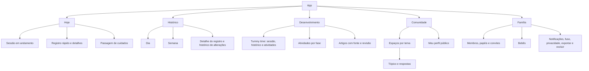
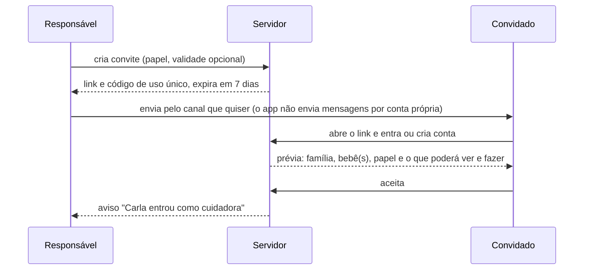

# Fluxos e telas

> Nota de 03/11/2026: o rumo mudou para site completo primeiro e port Android e iOS depois ([ADR-009](../06_ADRs/ADR-009_Site_Completo_Primeiro.md)). Onde este texto fala em app nativo, leia como o port; o site cobre as mesmas funções.

Proposta do Hermes para a experiência mobile em Android e iOS. A navegação é hipótese a testar com cuidadores reais; nada aqui é layout final nem identidade visual. Os wireframes são esquemas de conteúdo, sem estilo.

## 1. Princípios

| Princípio | Como aparece no produto | Como validar |
| --- | --- | --- |
| Registrar em até 2 toques a partir de Hoje | Botões rápidos para os tipos mais usados; detalhes opcionais depois | Teste de usabilidade com 5 a 8 cuidadores: toques e segundos até o registro salvo |
| Uma mão, no colo | Ações principais na metade de baixo da tela; alvos de pelo menos 48 x 48 dp no Android e 44 x 44 pt no iOS | Medição nos protótipos; Accessibility Scanner e Accessibility Inspector |
| Madrugada | Tema escuro de baixo brilho, sem fundos brancos; animações mínimas; vibração discreta como confirmação | Teste em quarto escuro; respeito a Reduzir Movimento |
| Erro reversível | "Desfazer" por alguns segundos depois de registrar; editar e excluir sempre acessíveis; exclusão restaurável por 30 dias | Teste de tarefa: corrigir um registro feito por engano |
| Sem cobrança | Linguagem neutra; nada de "atrasado", metas, pontos ou rankings | Revisão de texto; perguntas pós-teste sobre culpa e pressão |
| Privado e público bem separados | A área da comunidade tem marca visual própria e indica sempre "público"; o resto do app é privado da família | Teste: perguntar o que outra pessoa veria de uma postagem |
| Acessível | Fonte ampliada até pelo menos 200% (Dynamic Type no iOS, escala de fonte no Android); leitor de tela com rótulos completos ("Iniciar sono de Lia"); contraste mínimo de 4,5:1 para texto comum | VoiceOver e TalkBack em aparelho físico; verificação de contraste |

As metas de toques e tempo são hipóteses de projeto, não resultados medidos.

## 2. Navegação proposta

Cinco abas, o máximo recomendado para barra inferior nas duas plataformas:



Alternativas a testar: quatro abas (Histórico dentro de Hoje) e Desenvolvimento como seção de Hoje. Critério: qual versão as pessoas usam sem explicação no teste de primeira semana.

## 3. Telas principais

### 3.1 Hoje

```text
┌───────────────────────────────────────┐
│ Lia · 3 meses            ⟳ Atualizado 03:12 │
│ ⚠ Sem conexão · 2 aguardando envio        │
├───────────────────────────────────────┤
│ EM ANDAMENTO                              │
│ ┌──────────────────────────────────┐ │
│ │ Sono  ·  1 h 12 min   (por Bruno) │ │
│ │ [ Encerrar ]        [ Ajustar ]   │ │
│ └──────────────────────────────────┘ │
│ PARA VOCÊ SABER (nota de Carla, 22:40)   │
│ "Pomada só à noite."                      │
│ ÚLTIMOS                                   │
│ Mamada há 2 h 10 · Fralda há 50 min      │
│ Tummy time ontem 17:30                    │
├───────────────────────────────────────┤
│ [ Sono ] [ Mamada ] [ Fralda ]            │
│ [ Tummy time ]  [ + Mais ]                │
├───────────────────────────────────────┤
│ Hoje  Histórico  Desenv.  Comunid.  Família │
└───────────────────────────────────────┘
```

- Os botões rápidos ficam embaixo, ao alcance do polegar.
- Tocar em Sono ou Tummy time inicia uma sessão; tocar em Fralda abre uma escolha de um toque (xixi, cocô, ambos) e salva.
- Toque longo num botão abre o registro retroativo, com início e fim.
- "Para você saber" mostra notas de passagem com destaque válido.

### 3.2 Sessão em andamento

```text
┌───────────────────────────────────────┐
│ Tummy time · Lia                          │
│            04:35                          │
│ Iniciado às 17:02 por Ana                 │
│ Atividade sugerida: "Espelho no chão" ›   │
│ [ Encerrar ]                              │
│ [ Encerrar e anotar ]  [ Descartar ]      │
└───────────────────────────────────────┘
```

O tempo é calculado a partir do início gravado (ver [Offline e temporizadores](../03_Arquitetura/Offline_Sincronizacao_e_Temporizadores.md)). No Android, uma notificação contínua mostra o cronômetro; no iOS, uma Live Activity, se a stack escolhida suportar (ver [Mobile e plataformas](../08_Referencias/Tecnologias/Mobile_e_Plataformas.md)).

### 3.3 Histórico

- Linha do tempo por dia, no fuso da família, com ícone, horário, duração e autor ("por Carla").
- Filtros por tipo; resumo do dia (totais e intervalos) e da semana em gráfico simples.
- Sessões que atravessam a meia-noite aparecem no dia em que começaram, com a marca "termina no dia seguinte".
- Tocar num registro abre o detalhe, com edição, exclusão e histórico de alterações.
- Sem interpretação clínica: o app mostra o que foi registrado, sem dizer se está "bom" ou "ruim". Estimativas, se um dia existirem, trazem premissas e limites.

### 3.4 Desenvolvimento

- Tummy time: botão de sessão, histórico de sessões (duração, horários) e atividades da fase com fonte e revisão.
- Atividades por fase: sugestões sem pontuação; "fizemos" opcional.
- Artigos: texto com autoria, fontes, revisor e data de revisão visíveis.
- Detalhes em [Desenvolvimento e conteúdo](../04_Comunidade_Conteudo/Desenvolvimento_e_Conteudo.md).

### 3.5 Comunidade

- Espaços por tema; dentro de cada um, tópicos com respostas.
- Selo permanente "Comunidade · público"; o autor aparece pelo perfil público.
- Busca por palavra e filtro por faixa de idade escolhida pelo autor.
- Menu de cada tópico ou resposta: denunciar, bloquear o autor, silenciar o tópico.
- Detalhes em [Comunidade e moderação](../04_Comunidade_Conteudo/Comunidade_e_Moderacao.md).

### 3.6 Família

- Membros com papel e validade; convites pendentes; revogar e mudar papel (só responsáveis).
- Bebês; fuso de referência da família; preferências de notificação; privacidade; exportar e excluir dados.

## 4. Fluxos críticos

### 4.1 Primeiro acesso

1. Tela de boas-vindas com uma frase do que o app faz e o aviso de que ele não substitui orientação profissional.
2. Criar conta: e-mail com código de uso único (proposta) ou login social. Se houver login social, o iOS precisa oferecer também uma opção equivalente à exigida pela diretriz 4.8 da App Store (ver [Privacidade, legal e lojas](../08_Referencias/Pesquisa_Privacidade_Legal_e_Lojas.md)).
3. Escolher "criar família" ou "tenho um convite".
4. Termos e política em linguagem simples, com o consentimento específico para os dados do bebê separado do resto (texto a validar juridicamente).

### 4.2 Cadastro do bebê

Nome ou apelido e data de nascimento. Nada mais é obrigatório. Explicação curta: "A data serve para mostrar atividades da fase; ela não aparece na comunidade".

### 4.3 Convite de outro cuidador



O responsável pode cancelar o convite enquanto ele está pendente. O convite exige conexão nas duas pontas.

### 4.4 Registro rápido

1. Em Hoje, tocar em "Fralda" e escolher o tipo. Salvo no aparelho na hora, com "desfazer" por alguns segundos.
2. Detalhes opcionais (horário diferente, observação) no próprio cartão do registro.
3. A marca "aguardando envio" some quando o servidor confirma.

### 4.5 Temporizador e troca de turno

1. Ana inicia o sono às 14:00. O cartão "Em andamento" aparece para todos os cuidadores depois da sincronização.
2. Bruno assume e encerra às 15:10. O detalhe mostra "iniciado por Ana · encerrado por Bruno".
3. Se os dois encerrarem quase juntos, vale o primeiro; diferença maior vira revisão (regras na seção 7 do documento de sincronização).

### 4.6 Correção e exclusão

- Editar horários com seletores grandes e acessíveis, sem teclado.
- Excluir com "desfazer"; depois, restauração por 30 dias na lixeira da família.
- Conflito: selo "precisa de revisão" e tela de comparação lado a lado, com autor e horário de cada versão.

### 4.7 Passagem de cuidados

"Desde que você saiu às 13:00": registros desde então, sessões em andamento e notas em destaque, numa tela só. É uma consulta sobre os dados existentes, sem tela de preenchimento extra.

### 4.8 Postar e responder

1. Escolher o espaço, escrever título e texto, ver a prévia com o selo "público" e publicar (exige conexão).
2. Responder a um tópico; uma resposta pode citar outra (um nível).
3. Incluir um resumo da rotina: a pessoa escolhe o período e os números; o app mostra exatamente o texto que será publicado; nada sai sem confirmação; o que vai é uma cópia, sem vínculo com os registros.

### 4.9 Denúncia e bloqueio

1. Menu da postagem: "Denunciar" com os motivos de [Comunidade e moderação, seção 7](../04_Comunidade_Conteudo/Comunidade_e_Moderacao.md): ataque ou assédio, informação de saúde perigosa, conteúdo sexual, exposição de criança, dados pessoais, spam ou venda, risco de autolesão (segue a rota de crise) e outro.
2. Confirmação: "Recebemos. A moderação analisa em até [prazo a definir]". Quem denunciou deixa de ver aquele conteúdo, se quiser.
3. "Bloquear [apelido]": efeito imediato e mútuo; a pessoa bloqueada não é avisada.

### 4.10 Revogação

1. O responsável abre o membro e toca em "Remover acesso".
2. Aviso honesto: "Carla perde o acesso assim que o aparelho dela se conectar. O que ela já viu ou guardou no aparelho enquanto estava offline não pode ser apagado na hora."
3. Do lado de Carla, ao reconectar: "Seu acesso à família de Lia foi encerrado. 2 registros feitos offline não foram enviados."

## 5. Estados de tela

| Estado | Onde aparece | Texto proposto |
| --- | --- | --- |
| Vazio | Hoje sem registros; Histórico novo; Comunidade sem tópicos no espaço | "Nenhum registro hoje. Toque em um botão abaixo para começar." |
| Carregando | Primeira sincronização; comunidade | Esqueleto da tela; nunca bloqueia o registro local |
| Sem conexão | Faixa no topo | "Sem conexão. Seus registros ficam salvos no aparelho." |
| Sincronização pendente | Faixa e marca no registro | "3 registros aguardando envio." |
| Conflito | Selo no registro e no Hoje | "Este registro foi alterado por duas pessoas. Escolha a versão certa." |
| Permissão negada (papel) | Ação de observador; ação de cuidador sobre registro alheio | "Seu papel nesta família permite só ver os registros." |
| Permissão negada (sistema) | Notificações negadas | "Sem notificações, você ainda registra e vê tudo dentro do app." |
| Acesso encerrado | Após revogação | Texto da seção 4.10 |
| Erro | Falha inesperada | O que aconteceu, o que foi preservado e o que fazer ("Seu registro está salvo no aparelho. Tentaremos enviar de novo.") |

## 6. Android e iOS

| Tema | Android | iOS |
| --- | --- | --- |
| Voltar | Gesto ou botão de voltar do sistema | Gesto de deslizar da borda |
| Cronômetro fora do app | Notificação contínua com cronômetro do sistema | Live Activity e Dynamic Island (iOS 16.1 ou posterior) |
| Atalho na tela inicial | Widget | Widget |
| Permissão de notificação | Pedida em tempo de execução a partir do Android 13 | Pedida pelo sistema; pode ser provisória |
| Fonte ampliada | Escala de fonte do sistema | Dynamic Type |
| Leitor de tela | TalkBack | VoiceOver |

As interfaces não precisam ser idênticas: componentes e gestos seguem o costume de cada plataforma, e o conteúdo e as regras são os mesmos.

## 7. O que não entra no MVP

Registro por voz, assistente de IA, previsão de sono, câmera ou monitor, relógio inteligente, chat em tempo real e salas de áudio. Ficam como hipóteses de expansão no [Roadmap](../07_Roadmap/Roadmap_e_Proxima_Fatia.md).

## Questões abertas

1. Cinco ou quatro abas.
2. Nome do grupo na interface ("Família" ou outro).
3. Quais tipos ganham botão rápido em Hoje (proposta: sono, mamada, fralda, tummy time).
4. Prazo de resposta da moderação exibido a quem denuncia.
5. Validade padrão do convite (proposta: 7 dias).

## Limites desta análise

Proposta sem protótipo navegável nem teste com usuários. As metas de toques, tempo e legibilidade são hipóteses a medir; as referências de concorrentes estão em [Concorrentes e diferenciais](../01_Produto/Concorrentes_e_Diferenciais.md).
