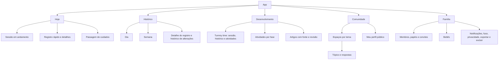
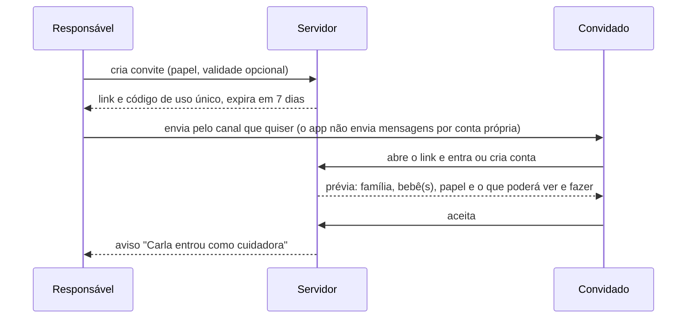

# Flows and screens

> Note from 03/11/2026: the direction changed to a full website first and an Android and iOS port later ([ADR-009](../06_ADRs/ADR-009_Site_Completo_Primeiro.md)). Where this text mentions a native app, read it as the port; the website covers the same functions.

Hermes's proposal for the mobile experience on Android and iOS. The navigation is a hypothesis to be tested with real caregivers; nothing here is a final layout or visual identity. The wireframes are content schematics, without styling.

## 1. Principles

| Principle | How it appears in the product | How to validate |
| --- | --- | --- |
| Log within 2 taps from Hoje | Quick buttons for the most used types; optional details afterwards | Usability test with 5 to 8 caregivers: taps and seconds until the record is saved |
| One hand, baby on the lap | Primary actions in the bottom half of the screen; targets of at least 48 x 48 dp on Android and 44 x 44 pt on iOS | Measurement in the prototypes; Accessibility Scanner and Accessibility Inspector |
| Middle of the night | Low-brightness dark theme, no white backgrounds; minimal animations; subtle vibration as confirmation | Test in a dark room; respect for Reduce Motion |
| Reversible errors | "Desfazer" for a few seconds after logging; edit and delete always accessible; deletion restorable for 30 days | Task test: correct a record made by mistake |
| No pressure | Neutral language; no "atrasado", goals, points or rankings | Copy review; post-test questions about guilt and pressure |
| Private and public clearly separated | The community area has its own visual mark and always shows "público"; the rest of the app is private to the family | Test: ask what another person would see of a post |
| Accessible | Font enlarged to at least 200% (Dynamic Type on iOS, font scale on Android); screen reader with complete labels ("Iniciar sono de Lia"); minimum contrast of 4,5:1 for regular text | VoiceOver and TalkBack on a physical device; contrast check |

The tap and time targets are design hypotheses, not measured results.

## 2. Proposed navigation

Five tabs, the maximum recommended for a bottom bar on both platforms:



Alternatives to test: four tabs (Histórico inside Hoje) and Desenvolvimento as a section of Hoje. Criterion: which version people use without explanation in the first-week test.

## 3. Main screens

### 3.1 Hoje

```text
┌───────────────────────────────────────┐
│ Lia · 3 meses            ⟳ Atualizado 03:12 │
│ ⚠ Sem conexão · 2 aguardando envio        │
├───────────────────────────────────────┤
│ EM ANDAMENTO                              │
│ ┌──────────────────────────────────┐ │
│ │ Sono  ·  1 h 12 min   (por Bruno) │ │
│ │ [ Encerrar ]        [ Ajustar ]   │ │
│ └──────────────────────────────────┘ │
│ PARA VOCÊ SABER (nota de Carla, 22:40)   │
│ "Pomada só à noite."                      │
│ ÚLTIMOS                                   │
│ Mamada há 2 h 10 · Fralda há 50 min      │
│ Tummy time ontem 17:30                    │
├───────────────────────────────────────┤
│ [ Sono ] [ Mamada ] [ Fralda ]            │
│ [ Tummy time ]  [ + Mais ]                │
├───────────────────────────────────────┤
│ Hoje  Histórico  Desenv.  Comunid.  Família │
└───────────────────────────────────────┘
```

- The quick buttons sit at the bottom, within reach of the thumb.
- Tapping Sono or Tummy time starts a session; tapping Fralda opens a one-tap choice (xixi, cocô, ambos) and saves.
- Long-pressing a button opens retroactive logging, with start and end.
- "Para você saber" shows handoff notes whose highlight is still valid.

### 3.2 Session in progress

```text
┌───────────────────────────────────────┐
│ Tummy time · Lia                          │
│            04:35                          │
│ Iniciado às 17:02 por Ana                 │
│ Atividade sugerida: "Espelho no chão" ›   │
│ [ Encerrar ]                              │
│ [ Encerrar e anotar ]  [ Descartar ]      │
└───────────────────────────────────────┘
```

The time is calculated from the recorded start (see [Offline and timers](../03_Arquitetura/Offline_Sincronizacao_e_Temporizadores.md)). On Android, an ongoing notification shows the timer; on iOS, a Live Activity, if the chosen stack supports it (see [Mobile and platforms](../08_Referencias/Tecnologias/Mobile_e_Plataformas.md)).

### 3.3 Histórico

- Timeline by day, in the family's time zone, with icon, time, duration and author ("por Carla").
- Filters by type; summary of the day (totals and intervals) and of the week in a simple chart.
- Sessions that cross midnight appear on the day they started, with the "termina no dia seguinte" mark.
- Tapping a record opens the detail view, with editing, deletion and change history.
- No clinical interpretation: the app shows what was logged, without saying whether it is "bom" or "ruim". Estimates, if they ever exist, come with assumptions and limits.

### 3.4 Desenvolvimento

- Tummy time: session button, session history (duration, times) and activities for the stage with source and review.
- Activities by stage: suggestions without scoring; optional "fizemos".
- Articles: text with authorship, sources, reviewer and review date visible.
- Details in [Development and content](../04_Comunidade_Conteudo/Desenvolvimento_e_Conteudo.md).

### 3.5 Comunidade

- Spaces by theme; inside each one, threads with replies.
- Permanent "Comunidade · público" badge; the author appears through their public profile.
- Search by keyword and filter by age range chosen by the author.
- Menu on each thread or reply: report, block the author, mute the thread.
- Details in [Community and moderation](../04_Comunidade_Conteudo/Comunidade_e_Moderacao.md).

### 3.6 Família

- Members with role and expiration; pending invitations; revoke and change role (guardians only).
- Babies; family reference time zone; notification preferences; privacy; export and delete data.

## 4. Critical flows

### 4.1 First access

1. Welcome screen with one sentence about what the app does and the notice that it does not replace professional guidance.
2. Create an account: email with a one-time code (proposal) or social login. If there is social login, iOS must also offer an option equivalent to the one required by App Store guideline 4.8 (see [Privacy, legal and stores](../08_Referencias/Pesquisa_Privacidade_Legal_e_Lojas.md)).
3. Choose "criar família" or "tenho um convite".
4. Terms and policy in plain language, with the specific consent for the baby's data separate from the rest (text to be legally validated).

### 4.2 Baby registration

Name or nickname and date of birth. Nothing else is required. Short explanation: "A data serve para mostrar atividades da fase; ela não aparece na comunidade".

### 4.3 Inviting another caregiver



The guardian can cancel the invitation while it is pending. The invitation requires a connection on both ends.

### 4.4 Quick logging

1. In Hoje, tap "Fralda" and choose the type. Saved on the device immediately, with "desfazer" for a few seconds.
2. Optional details (different time, note) on the record card itself.
3. The "aguardando envio" mark disappears when the server confirms.

### 4.5 Timer and shift change

1. Ana starts sleep at 14:00. The "Em andamento" card appears for all caregivers after syncing.
2. Bruno takes over and ends it at 15:10. The detail view shows "iniciado por Ana · encerrado por Bruno".
3. If both end it at almost the same time, the first one wins; a larger difference goes to review (rules in section 7 of the sync document).

### 4.6 Correction and deletion

- Edit times with large, accessible pickers, without the keyboard.
- Delete with "desfazer"; afterwards, restoration for 30 days from the family's trash.
- Conflict: "precisa de revisão" badge and a side-by-side comparison screen, with the author and time of each version.

### 4.7 Care handoff

"Desde que você saiu às 13:00": records since then, sessions in progress and highlighted notes, on a single screen. It is a query over existing data, with no extra form screen.

### 4.8 Posting and replying

1. Choose the space, write a title and text, see the preview with the "público" badge and publish (requires a connection).
2. Reply to a thread; a reply can quote another (one level).
3. Include a routine summary: the person chooses the period and the numbers; the app shows exactly the text that will be published; nothing goes out without confirmation; what goes out is a copy, with no link to the records.

### 4.9 Reporting and blocking

1. Post menu: "Denunciar" with the reasons from [Community and moderation, section 7](../04_Comunidade_Conteudo/Comunidade_e_Moderacao.md): attack or harassment, dangerous health information, sexual content, exposure of a child, personal data, spam or sales, risk of self-harm (follows the crisis route) and other.
2. Confirmation: "Recebemos. A moderação analisa em até [prazo a definir]". The person who reported stops seeing that content, if they wish.
3. "Bloquear [apelido]": immediate and mutual effect; the blocked person is not notified.

### 4.10 Revocation

1. The guardian opens the member and taps "Remover acesso".
2. Honest warning: "Carla perde o acesso assim que o aparelho dela se conectar. O que ela já viu ou guardou no aparelho enquanto estava offline não pode ser apagado na hora."
3. On Carla's side, upon reconnecting: "Seu acesso à família de Lia foi encerrado. 2 registros feitos offline não foram enviados."

## 5. Screen states

| State | Where it appears | Proposed text |
| --- | --- | --- |
| Empty | Hoje with no records; new Histórico; Comunidade with no threads in the space | "Nenhum registro hoje. Toque em um botão abaixo para começar." |
| Loading | First sync; community | Screen skeleton; never blocks local logging |
| No connection | Banner at the top | "Sem conexão. Seus registros ficam salvos no aparelho." |
| Sync pending | Banner and mark on the record | "3 registros aguardando envio." |
| Conflict | Badge on the record and on Hoje | "Este registro foi alterado por duas pessoas. Escolha a versão certa." |
| Permission denied (role) | Observer action; caregiver action on someone else's record | "Seu papel nesta família permite só ver os registros." |
| Permission denied (system) | Notifications denied | "Sem notificações, você ainda registra e vê tudo dentro do app." |
| Access ended | After revocation | Text from section 4.10 |
| Error | Unexpected failure | What happened, what was preserved and what to do ("Seu registro está salvo no aparelho. Tentaremos enviar de novo.") |

## 6. Android and iOS

| Topic | Android | iOS |
| --- | --- | --- |
| Back | System back gesture or button | Edge swipe gesture |
| Timer outside the app | Ongoing notification with the system chronometer | Live Activity and Dynamic Island (iOS 16.1 or later) |
| Home screen shortcut | Widget | Widget |
| Notification permission | Requested at runtime starting with Android 13 | Requested by the system; can be provisional |
| Enlarged font | System font scale | Dynamic Type |
| Screen reader | TalkBack | VoiceOver |

The interfaces do not need to be identical: components and gestures follow each platform's conventions, while the content and rules are the same.

## 7. What is not in the MVP

Voice logging, AI assistant, sleep prediction, camera or monitor, smartwatch, real-time chat and audio rooms. They remain as expansion hypotheses in the [Roadmap](../07_Roadmap/Roadmap_e_Proxima_Fatia.md).

## Open questions

1. Five or four tabs.
2. Name of the group in the interface ("Família" or another).
3. Which types get a quick button in Hoje (proposal: sleep, feeding, diaper, tummy time).
4. Moderation response time shown to the person who reports.
5. Default invitation validity (proposal: 7 days).

## Limits of this analysis

Proposal without a navigable prototype or user testing. The tap, time and readability targets are hypotheses to be measured; the competitor references are in [Competitors and differentiators](../01_Produto/Concorrentes_e_Diferenciais.md).
