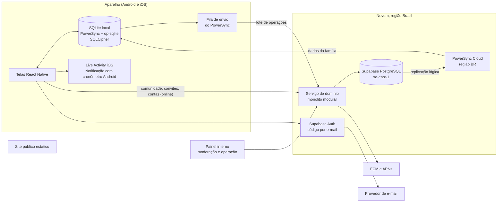
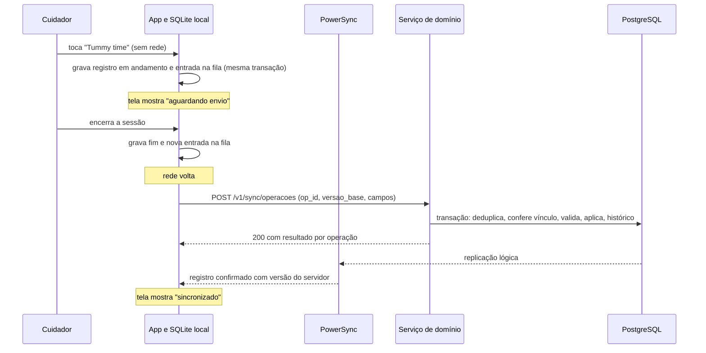

# Arquitetura proposta

> Nota de 03/11/2026: o rumo mudou para site completo primeiro e port Android e iOS depois ([ADR-009](../06_ADRs/ADR-009_Site_Completo_Primeiro.md)). Onde este texto fala em app nativo, leia como o port; o site cobre as mesmas funções.

Proposta do Hermes, derivada da recomendação em [Comparação de arquiteturas](Comparacao_de_Arquiteturas.md). Não foi aprovada nem construída. Descreve fronteiras, responsabilidades, interfaces e o caminho dos dados; regras de negócio estão em [Modelo de dados e permissões](Modelo_de_Dados_e_Permissoes.md) e [Offline, sincronização e temporizadores](Offline_Sincronizacao_e_Temporizadores.md), que valem para qualquer conjunto.

## 1. Visão geral

Princípio central: **o aparelho propõe, o serviço de domínio decide.** O PowerSync transporta dados (fila de envio e download por família), mas nenhuma regra de negócio mora nele. Toda escrita em dados de cuidado passa pelo serviço; os clientes não escrevem direto no banco.

## 2. Responsabilidades

| Componente | Responsável por | Não faz |
| --- | --- | --- |
| App (React Native + Expo) | Telas; gravação local na mesma transação da fila; estados visíveis (aguardando envio, sincronizado, conflito, não enviado); cronômetro derivado do início gravado; Live Activity e notificação com cronômetro; licença local de 14 dias por família | Decidir permissão; resolver conflito sozinho; guardar dados de outra família |
| SQLite local (PowerSync + op-sqlite) | Cópia dos dados das famílias com vínculo ativo; fila durável de envio; tabelas só locais (resultado de cada operação, rascunhos) | Ser fonte de verdade final |
| PowerSync Cloud | Entregar a cada aparelho só os dados das famílias em que a pessoa tem vínculo ativo (Sync Streams); remover do aparelho o que sai do escopo; encaminhar a fila ao serviço | Validar escritas: os Sync Streams "do not apply to uploaded data" (https://docs.powersync.com/integrations/supabase/rls-and-sync-streams) |
| Serviço de domínio | Autoridade de escrita: idempotência, vínculo atual, validação, versão-base, conflitos, histórico; convites e papéis; comunidade online; moderação; publicação de conteúdo; exportação e exclusão; push; auditoria | Expor dados de cuidado à comunidade ou ao painel |
| PostgreSQL (Supabase) | Fonte de verdade; restrições únicas; transações; RLS como defesa em profundidade | Aceitar escrita direta dos apps em tabelas de cuidado |
| Supabase Auth | Contas, código de uso único por e-mail, emissão de JWT curto | Autorizar acesso a família (isso é o vínculo no banco) |
| Painel interno | Fila de denúncias, ações de moderação, conteúdo editorial, suporte limitado, com MFA e auditoria | Ler dados de cuidado |
| Site estático | Apresentação, política, termos, regras da comunidade, pedido de exclusão de conta, contato | Login de usuários |

## 3. Módulos do serviço de domínio

Um processo só (monólito modular), com módulos de fronteira clara. Cada módulo usa um papel de banco próprio, para que a separação valha também no banco, e não só no código.

| Módulo | Dados que escreve | Papel de banco proposto | Lê |
| --- | --- | --- | --- |
| Identidade | Contas, dispositivos, tokens de push | `svc_identidade` | — |
| Família | Famílias, vínculos (com época), convites, bebês | `svc_familia` | Identidade |
| Cuidado | Registros, segmentos, notas, histórico de alterações, operações processadas, propostas pendentes | `svc_cuidado` | Família (vínculo atual) |
| Comunidade | Perfis públicos, espaços, tópicos, respostas, denúncias, bloqueios | `svc_comunidade`, **sem permissão nenhuma nas tabelas de cuidado e de família** | Identidade (só a ligação conta ↔ perfil, no servidor) |
| Moderação e operação | Ações de moderação, papéis de plataforma, auditoria | `svc_operacao`, sem permissão nas tabelas de cuidado | Comunidade |
| Conteúdo | Conteúdos e versões | `svc_conteudo` | — |
| Privacidade | Pedidos de exportação e exclusão, expurgo, lista de exclusões | `svc_privacidade` (permissão de apagar, com auditoria) | Todos, no escopo do pedido |
| Notificações | Fila de envio de push | `svc_notificacoes` | Vínculos ativos e tokens |

Esquemas de banco correspondentes: `identidade`, `familia`, `cuidado`, `comunidade`, `operacao`, `conteudo`. O papel de replicação do PowerSync lê só `familia`, `cuidado` e o necessário de `conteudo`. Os papéis expostos aos apps pela API automática do Supabase não recebem permissão de escrita em nenhum desses esquemas; a RLS fica ligada e negando por padrão, como defesa em profundidade (o papel `service_role` ignora RLS e fica só no servidor: https://supabase.com/docs/guides/database/postgres/row-level-security).

## 4. Interfaces

### 4.1 Envio da fila (escrita de cuidado)

- O app grava no SQLite local; o PowerSync põe a mudança na fila de envio. Cada linha alterada leva `op_id` (UUIDv7 gerado no aparelho) e, em edições, `versao_base` (a versão que o aparelho conhecia).
- O conector `uploadData()` do app envia a fila em lote para `POST /v1/sync/operacoes` com o JWT da sessão.
- O serviço processa cada operação numa transação: deduplica por `op_id`; confere o vínculo atual (estado, papel, validade, época); valida; compara a versão-base; aplica, mescla ou grava proposta pendente; registra o histórico; sobe a versão.
- Resposta HTTP 200 com um resultado por operação: `aplicada`, `mesclada`, `ja_processada`, `conflito` ou `rejeitada` (com motivo: `sem_permissao`, `vinculo_encerrado`, `validacao`, `registro_excluido`). A documentação do PowerSync pede que erros de validação ou conflito voltem como 2xx com detalhe, porque 4xx bloqueia a fila, e reserva 5xx para falhas temporárias (https://docs.powersync.com/handling-writes/writing-client-changes).
- O conector grava os resultados numa tabela só local, que alimenta os estados "não enviado" e "precisa de revisão" na tela.
- As propostas pendentes de conflito descem pelo sync para todos os cuidadores da família, para que qualquer um com permissão resolva.

### 4.2 Download (leitura de cuidado)

- Sync Streams por usuário: vínculos ativos da pessoa e, para cada família com vínculo ativo, bebês, registros (janela proposta de 90 dias), segmentos, notas, membros e propostas pendentes.
- O parâmetro de família vem de consulta à tabela de vínculos, não de claim no token; apagar ou revogar o vínculo tira a família dos buckets e o cliente remove as linhas na sincronização seguinte (https://docs.powersync.com/sync/rules/parameter-queries, https://docs.powersync.com/architecture/powersync-protocol).
- Registros mais antigos que a janela: consulta online ao serviço, sob demanda.

### 4.3 API online do serviço

| Grupo | Exemplos de rota | Observação |
| --- | --- | --- |
| Conta e dispositivo | registrar dispositivo e token de push; preferências; pedir exportação; pedir exclusão | Exclusão também pelo site (exigência do Google Play) |
| Família | criar família; cadastrar bebê; criar convite; aceitar convite; mudar papel; revogar; sair; transferir responsabilidade | Ações de segurança só online |
| Comunidade | espaços; tópicos; respostas; denunciar; bloquear; silenciar; meu perfil público | Online; rascunho local só no aparelho |
| Conteúdo | pacote de conteúdo por versão e lista de retirada | Formato definido em [Desenvolvimento e conteúdo](../04_Comunidade_Conteudo/Desenvolvimento_e_Conteudo.md); usar um stream global do PowerSync é alternativa a medir na prova |
| Operação (painel) | fila de denúncias; ações; auditoria; publicação editorial | Papel de plataforma, MFA, trilha de auditoria |

O contrato é descrito em OpenAPI e JSON Schema, independentes de linguagem; os tipos do app e do painel são gerados a partir dele.

### 4.4 Autenticação

- Supabase Auth com código de uso único por e-mail, por um provedor de e-mail próprio (o SMTP padrão do Supabase "is not meant for production use", segundo a nota de dados).
- JWT de vida curta; refresh revogável no servidor. O JWT prova quem é a pessoa; a família e o papel vêm sempre da tabela de vínculos (o próprio Supabase alerta que o JWT "is not always up-to-date": https://supabase.com/docs/guides/database/postgres/row-level-security).
- Sem login social no MVP, o que afasta a exigência da diretriz 4.8 da App Store.
- Painel com MFA obrigatório.

## 5. Caminho dos dados

### 5.1 Registro offline até a confirmação

### 5.2 Revogação

1. O responsável revoga pelo app (online). O serviço marca o vínculo como revogado, sobe a época, remove os tokens de push daquela conta para a família e registra auditoria.
2. O PowerSync deixa de entregar a família àquela conta; o aparelho remove as linhas na próxima sincronização.
3. Operações pendentes do aparelho revogado voltam como `rejeitada: vinculo_encerrado`; o app descarta a fila daquela família e mostra quantas operações não foram enviadas.
4. Aparelho que não sincroniza há mais de 14 dias esconde os dados da família até revalidar (licença local).
5. Limites honestos: o que já estava no aparelho offline continua lá até a reconexão ou o vencimento da licença; ver [Offline e temporizadores](Offline_Sincronizacao_e_Temporizadores.md), seção 11.

### 5.3 Comunidade e moderação

1. O app publica pelo serviço (online). O módulo de comunidade grava com o perfil público; ele não tem permissão de banco para ler cuidado ou família.
2. Uma denúncia entra na fila do painel; o moderador vê o conteúdo, o perfil público e o histórico de moderação daquele perfil, nunca a família.
3. Ações de moderação ficam na trilha de auditoria; o autor recebe aviso. Detalhes em [Comunidade e moderação](../04_Comunidade_Conteudo/Comunidade_e_Moderacao.md).

## 6. Cronômetro e notificações

- O cronômetro é sempre derivado do início gravado no SQLite.
- iOS: Live Activity pelo `expo-widgets`, com texto de timer desenhado pelo sistema; encerrada pelo sistema depois de 8 horas, quando o app mostra o estado real ao abrir.
- Android: notificação contínua com cronômetro do sistema, por um módulo Expo pequeno em Kotlin; promoção a Live Update só para sessões iniciadas no próprio aparelho, como pede a regra do Android.
- Push entre cuidadores: o serviço envia só a dispositivos de contas com vínculo ativo, com texto neutro.
- Fonte: [Mobile e plataformas](../08_Referencias/Tecnologias/Mobile_e_Plataformas.md), seção 4.

## 7. Ambientes

| Ambiente | Composição | Uso |
| --- | --- | --- |
| Local (Windows) | Docker com PostgreSQL, PowerSync Open Edition (imagem `journeyapps/powersync-service`) e o serviço; emulador e aparelho Android; development build no iPhone via EAS | Testes de integração do protocolo sem nuvem |
| Homologação | Projetos separados no Supabase e no PowerSync, dados fictícios | Testes de ponta a ponta e builds de teste |
| Produção | Supabase sa-east-1 e PowerSync região BR, planos pagos (os gratuitos pausam por inatividade) | Piloto e lançamento |

## 8. Tradeoffs aceitos

| Ganho | Custo aceito |
| --- | --- |
| Fila durável e download parcial prontos | Dois fornecedores (Supabase e PowerSync) e custo fixo maior no início |
| Regras de escrita num lugar só (serviço) | Serviço próprio para construir, testar e operar |
| Comunidade isolada também no banco | Mais papéis de banco para manter |
| Dados de cuidado hospedados no Brasil | Preços das regiões do Brasil ainda não confirmados |
| Saída para o Conjunto C sem refazer o servidor | Leitura nos Sync Streams precisa espelhar as regras do serviço, com testes nos dois caminhos |

## 9. Caminho de evolução

1. Se o PowerSync for trocado: manter esquema, serviço e contrato de envio; acrescentar endpoint de pull por cursor e cliente de sync próprio (Conjunto C da comparação).
2. App web para cuidadores, se aprovado: SDK Web do PowerSync, que é GA.
3. Anexos: Supabase Storage com prefixo por família, quarentena e remoção de metadados no servidor antes de publicar.
4. Escala: auto-hospedar o PowerSync Open Edition ou mudar de plano, conforme custo medido.

## Questões abertas

1. Linguagem do serviço de domínio ([ADR-003](../06_ADRs/ADR-003_Backend_Persistencia_Autenticacao.md)).
2. Conteúdo editorial por pacote assinado ou por stream global do PowerSync.
3. Janela local de 90 dias e licença de 14 dias (valores a medir).
4. Expo Push Service ou FCM e APNs direto.

## Limites desta análise

Desenho sem implementação. O comportamento do PowerSync e do Supabase vem da documentação oficial lida em 22/10/2026; o encaixe com o protocolo de [Offline e temporizadores](Offline_Sincronizacao_e_Temporizadores.md) precisa ser provado na prova técnica (MAT-17).
