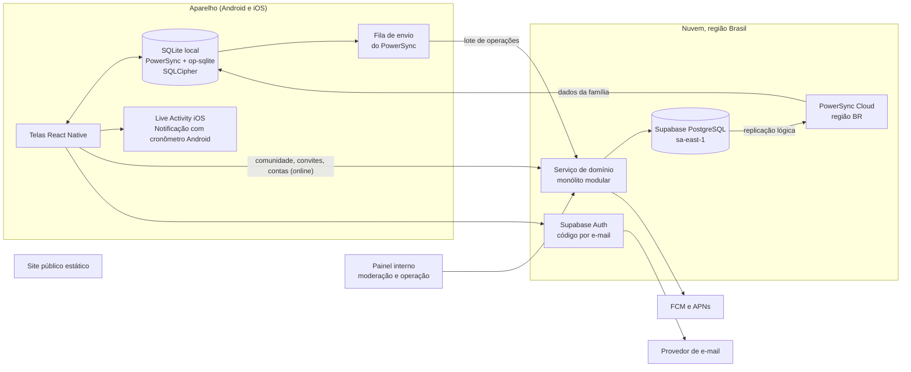
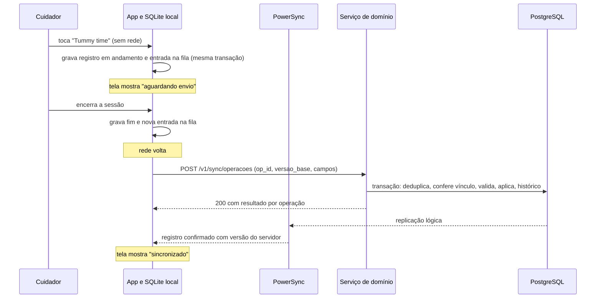

# Proposed architecture

> Note from 03/11/2026: the direction changed to a full website first and an Android and iOS port later ([ADR-009](../06_ADRs/ADR-009_Site_Completo_Primeiro.md)). Where this text refers to a native app, read it as the port; the website covers the same functions.

Hermes's proposal, derived from the recommendation in [Architecture comparison](Comparacao_de_Arquiteturas.md). It has not been approved or built. It describes boundaries, responsibilities, interfaces and the data path; business rules are in [Data model and permissions](Modelo_de_Dados_e_Permissoes.md) and [Offline, synchronization and timers](Offline_Sincronizacao_e_Temporizadores.md), which apply to any set.

## 1. Overview

Core principle: **the device proposes, the domain service decides.** PowerSync transports data (upload queue and per-family download), but no business rule lives in it. Every write to care data goes through the service; clients do not write directly to the database.

## 2. Responsibilities

| Component | Responsible for | Does not |
| --- | --- | --- |
| App (React Native + Expo) | Screens; local write in the same transaction as the queue; visible states (awaiting upload, synced, conflict, not sent); timer derived from the recorded start; Live Activity and notification with timer; local lease of 14 days per family | Decide permissions; resolve conflicts on its own; store another family's data |
| Local SQLite (PowerSync + op-sqlite) | Copy of the data of families with an active membership; durable upload queue; local-only tables (result of each operation, drafts) | Act as the final source of truth |
| PowerSync Cloud | Deliver to each device only the data of the families in which the person has an active membership (Sync Streams); remove from the device whatever leaves scope; forward the queue to the service | Validate writes: Sync Streams "do not apply to uploaded data" (https://docs.powersync.com/integrations/supabase/rls-and-sync-streams) |
| Domain service | Write authority: idempotency, current membership, validation, base version, conflicts, history; invitations and roles; online community; moderation; content publishing; export and deletion; push; auditing | Expose care data to the community or the dashboard |
| PostgreSQL (Supabase) | Source of truth; unique constraints; transactions; RLS as defense in depth | Accept direct writes from the apps to care tables |
| Supabase Auth | Accounts, one-time code by email, issuance of short-lived JWTs | Authorize access to a family (that is the membership in the database) |
| Internal dashboard | Report queue, moderation actions, editorial content, limited support, with MFA and auditing | Read care data |
| Static website | Presentation, policy, terms, community rules, account deletion request, contact | User login |

## 3. Domain service modules

A single process (modular monolith), with clearly bounded modules. Each module uses its own database role, so that the separation holds in the database too, and not only in the code.

| Module | Data it writes | Proposed database role | Reads |
| --- | --- | --- | --- |
| Identity | Accounts, devices, push tokens | `svc_identidade` | — |
| Family | Families, memberships (with epoch), invitations, babies | `svc_familia` | Identity |
| Care | Records, segments, notes, change history, processed operations, pending proposals | `svc_cuidado` | Family (current membership) |
| Community | Public profiles, spaces, topics, replies, reports, blocks | `svc_comunidade`, **with no permission at all on the care and family tables** | Identity (only the account ↔ profile link, on the server) |
| Moderation and operations | Moderation actions, platform roles, auditing | `svc_operacao`, with no permission on the care tables | Community |
| Content | Content items and versions | `svc_conteudo` | — |
| Privacy | Export and deletion requests, purge, deletion list | `svc_privacidade` (delete permission, with auditing) | All, within the scope of the request |
| Notifications | Push delivery queue | `svc_notificacoes` | Active memberships and tokens |

Corresponding database schemas: `identidade`, `familia`, `cuidado`, `comunidade`, `operacao`, `conteudo`. The PowerSync replication role reads only `familia`, `cuidado` and what is needed from `conteudo`. The roles exposed to the apps through Supabase's automatic API receive no write permission on any of these schemas; RLS stays enabled and denying by default, as defense in depth (the `service_role` role bypasses RLS and stays on the server only: https://supabase.com/docs/guides/database/postgres/row-level-security).

## 4. Interfaces

### 4.1 Queue upload (care writes)

- The app writes to the local SQLite; PowerSync puts the change in the upload queue. Each changed row carries `op_id` (UUIDv7 generated on the device) and, for edits, `versao_base` (the version the device knew).
- The app's `uploadData()` connector sends the queue in batches to `POST /v1/sync/operacoes` with the session JWT.
- The service processes each operation in a transaction: deduplicates by `op_id`; checks the current membership (status, role, validity, epoch); validates; compares the base version; applies, merges or stores a pending proposal; records the history; bumps the version.
- HTTP 200 response with one result per operation: `aplicada`, `mesclada`, `ja_processada`, `conflito` or `rejeitada` (with a reason: `sem_permissao`, `vinculo_encerrado`, `validacao`, `registro_excluido`). The PowerSync documentation asks that validation or conflict errors come back as 2xx with details, because 4xx blocks the queue, and reserves 5xx for temporary failures (https://docs.powersync.com/handling-writes/writing-client-changes).
- The connector writes the results to a local-only table, which feeds the "não enviado" and "precisa de revisão" states on screen.
- Pending conflict proposals come down through sync to all of the family's caregivers, so that anyone with permission can resolve them.

### 4.2 Download (care reads)

- Per-user Sync Streams: the person's active memberships and, for each family with an active membership, babies, records (proposed window of 90 days), segments, notes, members and pending proposals.
- The family parameter comes from a query on the memberships table, not from a token claim; deleting or revoking the membership removes the family from the buckets, and the client removes the rows on the next sync (https://docs.powersync.com/sync/rules/parameter-queries, https://docs.powersync.com/architecture/powersync-protocol).
- Records older than the window: online query to the service, on demand.

### 4.3 Online service API

| Group | Example routes | Notes |
| --- | --- | --- |
| Account and device | register device and push token; preferences; request export; request deletion | Deletion also via the website (Google Play requirement) |
| Family | create family; register baby; create invitation; accept invitation; change role; revoke; leave; transfer responsibility | Security actions online only |
| Community | spaces; topics; replies; report; block; mute; my public profile | Online; local draft on the device only |
| Content | content package by version and withdrawal list | Format defined in [Development and content](../04_Comunidade_Conteudo/Desenvolvimento_e_Conteudo.md); using a global PowerSync stream is an alternative to be measured in the proof of concept |
| Operations (dashboard) | report queue; actions; audit; editorial publishing | Platform role, MFA, audit trail |

The contract is described in OpenAPI and JSON Schema, which are language-independent; the app and dashboard types are generated from it.

### 4.4 Authentication

- Supabase Auth with a one-time code by email, through our own email provider (Supabase's default SMTP "is not meant for production use", according to the data note).
- Short-lived JWT; refresh revocable on the server. The JWT proves who the person is; the family and role always come from the memberships table (Supabase itself warns that the JWT "is not always up-to-date": https://supabase.com/docs/guides/database/postgres/row-level-security).
- No social login in the MVP, which avoids the requirement of App Store guideline 4.8.
- Dashboard with mandatory MFA.

## 5. Data path

### 5.1 Offline record through confirmation

### 5.2 Revocation

1. The responsible caregiver revokes through the app (online). The service marks the membership as revoked, bumps the epoch, removes that account's push tokens for the family and records an audit entry.
2. PowerSync stops delivering the family to that account; the device removes the rows on the next sync.
3. Pending operations from the revoked device come back as `rejeitada: vinculo_encerrado`; the app discards that family's queue and shows how many operations were not sent.
4. A device that has not synced for more than 14 days hides the family's data until it revalidates (local lease).
5. Honest limits: whatever was already on the offline device stays there until reconnection or until the lease expires; see [Offline and timers](Offline_Sincronizacao_e_Temporizadores.md), section 11.

### 5.3 Community and moderation

1. The app publishes through the service (online). The community module writes using the public profile; it has no database permission to read care or family data.
2. A report enters the dashboard queue; the moderator sees the content, the public profile and that profile's moderation history, never the family.
3. Moderation actions are kept in the audit trail; the author receives a notice. Details in [Community and moderation](../04_Comunidade_Conteudo/Comunidade_e_Moderacao.md).

## 6. Timer and notifications

- The timer is always derived from the start recorded in SQLite.
- iOS: Live Activity via `expo-widgets`, with timer text rendered by the system; ended by the system after 8 hours, after which the app shows the actual state when opened.
- Android: ongoing notification with a system chronometer, through a small Expo module in Kotlin; promotion to Live Update only for sessions started on the device itself, as the Android rule requires.
- Push between caregivers: the service sends only to devices of accounts with an active membership, with neutral text.
- Source: [Mobile and platforms](../08_Referencias/Tecnologias/Mobile_e_Plataformas.md), section 4.

## 7. Environments

| Environment | Composition | Use |
| --- | --- | --- |
| Local (Windows) | Docker with PostgreSQL, PowerSync Open Edition (image `journeyapps/powersync-service`) and the service; Android emulator and device; development build on the iPhone via EAS | Protocol integration tests without the cloud |
| Staging | Separate projects in Supabase and PowerSync, fictitious data | End-to-end tests and test builds |
| Production | Supabase sa-east-1 and PowerSync BR region, paid plans (the free ones pause due to inactivity) | Pilot and launch |

## 8. Accepted tradeoffs

| Gain | Accepted cost |
| --- | --- |
| Durable queue and partial download out of the box | Two vendors (Supabase and PowerSync) and a higher fixed cost at the start |
| Write rules in a single place (the service) | An in-house service to build, test and operate |
| Community isolated in the database too | More database roles to maintain |
| Care data hosted in Brazil | Prices for the Brazil regions not yet confirmed |
| A path to Set C without rebuilding the server | Reads in Sync Streams must mirror the service's rules, with tests on both paths |

## 9. Evolution path

1. If PowerSync is replaced: keep the schema, the service and the upload contract; add a cursor-based pull endpoint and an in-house sync client (Set C in the comparison).
2. Web app for caregivers, if approved: the PowerSync Web SDK, which is GA.
3. Attachments: Supabase Storage with a per-family prefix, quarantine and server-side metadata removal before publishing.
4. Scale: self-host PowerSync Open Edition or change plans, depending on measured cost.

## Open questions

1. Language of the domain service ([ADR-003](../06_ADRs/ADR-003_Backend_Persistencia_Autenticacao.md)).
2. Editorial content via a signed package or via a global PowerSync stream.
3. Local window of 90 days and lease of 14 days (values to be measured).
4. Expo Push Service, or FCM and APNs directly.

## Limits of this analysis

Design without implementation. The behavior of PowerSync and Supabase comes from the official documentation read on 22/10/2026; the fit with the protocol in [Offline and timers](Offline_Sincronizacao_e_Temporizadores.md) needs to be proven in the technical proof of concept (MAT-17).
