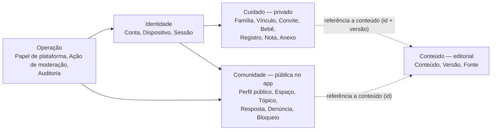
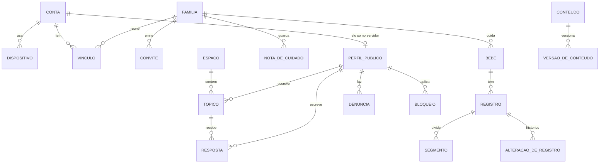

# Modelo de dados e permissões

> Nota de 03/11/2026: o rumo mudou para site completo primeiro e port Android e iOS depois ([ADR-009](../06_ADRs/ADR-009_Site_Completo_Primeiro.md)). Onde este texto fala em app nativo, leia como o port; o site cobre as mesmas funções.

Proposta do Hermes, ainda não aprovada por Daniel. O modelo é lógico: vale para qualquer um dos conjuntos de arquitetura comparados em [Comparação de arquiteturas](Comparacao_de_Arquiteturas.md). Nomes de tabelas, tipos de coluna e índices ficam para a implementação.

## 1. Problema

O aplicativo guarda dados de bebês registrados por vários adultos, de várias famílias independentes, e ao mesmo tempo tem uma comunidade aberta a pessoas que não pertencem a essas famílias. Três riscos orientam o modelo:

1. Uma família ler ou alterar dados de outra, por consulta, sincronização, arquivo ou notificação.
2. A comunidade virar caminho de acesso à rotina privada de uma criança.
3. Um cuidador removido continuar escrevendo com uma permissão antiga guardada no aparelho ou no token.

## 2. Fronteiras de domínio

O modelo se divide em cinco contextos. Cada um tem dono, regras e armazenamento lógico próprios; as setas mostram as únicas referências permitidas entre eles.

Regras da fronteira:

- **Cuidado** e **Comunidade** não se referenciam. Nenhuma entidade da comunidade guarda chave de Família, Bebê ou Registro. Quando alguém compartilha algo da rotina, o que vai para a comunidade é uma cópia do texto que a pessoa revisou e confirmou, sem vínculo de volta (seção 6).
- O elo entre a Conta e o Perfil público existe só no servidor. Outros usuários e a tela comum de moderação veem apenas o perfil público.
- **Operação** atua sobre Comunidade e Identidade. Moderação não tem caminho para dados de Cuidado.
- **Conteúdo** é somente leitura para usuários; registros podem citar uma atividade pelo id e pela versão lida.

## 3. Entidades

Legenda da coluna Fase: **MVP** entra na primeira versão utilizável; **Fundação** precisa existir já na primeira fatia técnica; **Depois** fica para expansões.

### 3.1 Identidade

| Entidade | Campos principais | Fase | Observações |
| --- | --- | --- | --- |
| Conta | id, e-mail de login, nome privado (visto só pela família), idioma, fuso preferido, estado (ativa, exclusão agendada, excluída), versões aceitas de termos e política | Fundação | Um adulto. Não existe conta de criança. |
| Dispositivo | id, conta, plataforma, versão do app, token de push (cifrado), último contato, sessão | Fundação | Revogar um dispositivo encerra a sessão dele sem afetar os outros. |

### 3.2 Cuidado (privado)

| Entidade | Campos principais | Fase | Observações |
| --- | --- | --- | --- |
| Família | id, nome, fuso de referência (IANA), criada por, criada em, estado | Fundação | "Grupo de cuidado" no modelo; o nome na interface fica para a pesquisa de linguagem (ver [Fluxos e telas](../02_Experiencia/Fluxos_e_Telas.md)). |
| Vínculo | família, conta, papel, estado (ativo, revogado, saiu), válido até (opcional), concedido por, criado em, encerrado em, época | Fundação | A "época" sobe a cada mudança de papel ou revogação; o servidor compara com a época que o aparelho conhece. |
| Convite | família, papel proposto, criado por, hash do código, expira em, usos restantes (1), estado (pendente, aceito, expirado, revogado), aceito por, aceito em | Fundação | O código em claro só aparece para quem convida; o servidor guarda o hash. |
| Bebê | id, família, nome ou apelido, data de nascimento, estado (ativo, arquivado), criado por | Fundação | Sexo, peso e foto ficam fora do MVP (minimização). A data de nascimento serve para idade e conteúdo por fase; nunca sai do contexto de Cuidado. |
| Registro | id (gerado no aparelho), família, bebê, tipo, estado (em andamento, concluído), início, fim, campos do tipo, nota, origem (ao vivo, retroativo), fuso e deslocamento no momento do registro, iniciado por, encerrado por, criado por, versão (do servidor), recebido em, excluído em, excluído por | Fundação | Uma sessão temporizada é um Registro em andamento; não há entidade "timer" separada (justificativa na seção 3.6). |
| Segmento | registro, lado ou parte, início, fim | MVP | Só para amamentação (lado esquerdo e direito). Pausas de tummy time viram sessões separadas. |
| Alteração de registro | registro, operação, autor, dispositivo, antes, depois, recebida em | Fundação | Histórico só de acréscimo. Sustenta autoria, conflitos e restauração. |
| Nota de cuidado | id, família, bebê (opcional), autor, texto, destaque até, criada em | MVP | Base da passagem de cuidados ("o que você precisa saber"). |
| Anexo | id, família, registro ou nota, tipo, tamanho, caminho no armazenamento, criado por | Depois | Fotos e arquivos ficam fora do MVP; o modelo já prevê escopo por família. |
| Operação de sincronização | id da operação, conta, dispositivo, família, tipo, entidade, versão-base, resultado, processada em | Fundação | Registro de idempotência no servidor (ver [Offline e sincronização](Offline_Sincronizacao_e_Temporizadores.md)). |

Tipos de Registro no MVP: sono (inclui sonecas), amamentação, mamadeira, alimentação sólida, fralda, tummy time e observação curta. Medicamentos, medidas de crescimento, temperatura, extração de leite e banho ficam como candidatos de expansão; alguns exigem cuidado adicional com dado de saúde.

### 3.3 Conteúdo (editorial)

| Entidade | Campos principais | Fase | Observações |
| --- | --- | --- | --- |
| Conteúdo | id, tipo (artigo, atividade), tema, faixa etária mínima e máxima em semanas, idioma | MVP | Atividades de tummy time e brincadeiras por fase. |
| Versão de conteúdo | conteúdo, número, texto, autores, revisor com credencial, fontes, licença ou atribuição, revisado em, próxima revisão, estado (rascunho, em revisão, publicado, retirado) | MVP | Ciclo editorial em [Desenvolvimento e conteúdo](../04_Comunidade_Conteudo/Desenvolvimento_e_Conteudo.md). |

### 3.4 Comunidade

| Entidade | Campos principais | Fase | Observações |
| --- | --- | --- | --- |
| Perfil público | id, apelido único, avatar (sem foto de criança por padrão), bio curta, faixa do bebê exibida (opcional, escolhida pela pessoa), estado (ativo, suspenso, banido) | MVP | Ligado à Conta apenas no servidor. A faixa exibida é uma escolha, não um cálculo a partir da data de nascimento. |
| Espaço | id, nome, descrição, regras específicas | MVP | Sono, alimentação, banho, tummy time, organização da rotina, divisão dos cuidados, dificuldades do dia a dia. |
| Tópico | id, espaço, autor (perfil público), título, corpo, faixa etária (etiqueta opcional), estado (visível, oculto para revisão, removido, travado), criado em, editado em | MVP | |
| Resposta | id, tópico, autor (perfil público), corpo, resposta a (um nível), estado, criada em, editada em | MVP | |
| Marcação "ajudou" | resposta, perfil público | Depois | Sem ranking público de pessoas. |
| Denúncia | id, alvo (tópico, resposta ou perfil), denunciante, motivo, texto, estado (aberta, em análise, procedente, improcedente), decidida por, decisão, decidida em | MVP | |
| Bloqueio | quem bloqueia, quem é bloqueado, criado em | MVP | Efeito mútuo: um deixa de ver o outro e não pode responder a ele. |

### 3.5 Operação

| Entidade | Campos principais | Fase | Observações |
| --- | --- | --- | --- |
| Papel de plataforma | conta, papel (moderador, suporte, administrador técnico), concedido por, válido até | MVP | Papel da equipe do produto, separado dos papéis na família. |
| Ação de moderação | id, moderador, alvo, ação (ocultar, remover, restaurar, advertir, suspender, banir, travar tópico), regra aplicada, denúncia, prazo, avisado ao autor em | MVP | |
| Evento de auditoria | quem, o quê, alvo, quando, origem | Fundação | Login, convite aceito, mudança de papel, revogação, exportação, exclusão, ações administrativas. Sem conteúdo dos registros. |

### 3.6 Fronteiras justificadas

- **Sessão temporizada como Registro em andamento.** O Baby Buddy separa o temporizador do registro e exige um passo de conversão; o Finnberry guarda o timer só no navegador. Aqui, a sessão já nasce como Registro com início e sem fim: outro cuidador vê e encerra a mesma entidade, a sincronização trata um objeto só e não há estado de timer para reconciliar. Detalhes e evidências nas fichas de [Baby Buddy](../08_Referencias/Repositorios/Baby_Buddy.md) e [Finnberry](../08_Referencias/Repositorios/Finnberry.md).
- **Observação curta como tipo de Registro e Nota de cuidado como entidade.** A observação ligada a um momento ("arrotou pouco") entra na linha do tempo; a nota de passagem ("pomada só à noite") tem destaque e validade e aparece no topo para quem assume o cuidado.
- **Sem entidade de "atividade feita" no MVP.** Fazer uma atividade sugerida pode virar uma sessão de tummy time com referência ao conteúdo; uma tabela própria só se houver uso demonstrado.
- **Anexos fora do MVP.** Reduzem o volume de dado sensível e o custo de armazenamento enquanto o núcleo é validado.

## 4. Diagrama lógico

## 5. Papéis e matriz de permissões

### 5.1 Papéis na família

| Papel | Para quem | Resumo |
| --- | --- | --- |
| Responsável | Mãe, pai ou outro responsável legal | Administra a família, os bebês, os convites e os dados. Pode haver mais de um. |
| Cuidador | Avó, babá, outro adulto de confiança | Registra e acompanha. Edita e exclui só o que ele mesmo criou, e pode encerrar qualquer sessão em andamento. |
| Observador | Quem só acompanha | Lê registros e notas; não escreve. |

Qualquer vínculo pode ter validade ("cuidador até domingo"). Vencida a validade, ele se comporta como revogado.

### 5.2 Papéis de plataforma

Moderador, suporte e administrador técnico são papéis da equipe do produto. Nenhum deles dá leitura de dados de cuidado. O suporte só vê dados de cuidado se a própria família pedir e autorizar no caso específico, com registro em auditoria; essa rotina é proposta para validação jurídica em [Privacidade e segurança](../05_Privacidade_Operacao/Privacidade_e_Seguranca.md).

### 5.3 Matriz

Legenda: ✔ permitido; ✖ negado; "próprio" só no que a pessoa criou.

| Ação | Responsável | Cuidador | Observador | Ex-membro ou vínculo vencido | Usuário só da comunidade | Moderador | Suporte |
| --- | --- | --- | --- | --- | --- | --- | --- |
| Ver registros e notas do bebê | ✔ | ✔ | ✔ | ✖ | ✖ | ✖ | ✖ (só com autorização da família no caso) |
| Criar registro ou nota | ✔ | ✔ | ✖ | ✖ | ✖ | ✖ | ✖ |
| Iniciar ou encerrar sessão em andamento | ✔ | ✔ (qualquer sessão) | ✖ | ✖ | ✖ | ✖ | ✖ |
| Editar registro | ✔ | próprio | ✖ | ✖ | ✖ | ✖ | ✖ |
| Excluir registro | ✔ | próprio | ✖ | ✖ | ✖ | ✖ | ✖ |
| Restaurar registro excluído (até 30 dias) | ✔ | próprio | ✖ | ✖ | ✖ | ✖ | ✖ |
| Ver histórico de alterações | ✔ | ✔ | ✖ | ✖ | ✖ | ✖ | ✖ |
| Cadastrar, editar ou arquivar bebê | ✔ | ✖ | ✖ | ✖ | ✖ | ✖ | ✖ |
| Convidar, revogar e mudar papel | ✔ | ✖ | ✖ | ✖ | ✖ | ✖ | ✖ |
| Sair da família | ✔ (se não for o último responsável) | ✔ | ✔ | — | — | — | — |
| Exportar dados da família | ✔ | ✖ | ✖ | ✖ | ✖ | ✖ | ✖ |
| Excluir a família | ✔ | ✖ | ✖ | ✖ | ✖ | ✖ | ✖ |
| Publicar, responder, denunciar e bloquear na comunidade | ✔ | ✔ | ✔ | ✔ | ✔ | ✔ | ✔ |
| Ver fila de denúncias e moderar | ✖ | ✖ | ✖ | ✖ | ✖ | ✔ | ✖ |
| Ver e-mail ou dados da conta de um autor | ✖ | ✖ | ✖ | ✖ | ✖ | ✖ (só o perfil público) | ✔ (com motivo registrado) |

A comunidade é aberta a qualquer conta, com ou sem família. Ter família não muda nada na comunidade, e participar da comunidade não muda nada na família.

## 6. Invariantes

O servidor garante as regras abaixo em toda operação, inclusive nas que chegam pela sincronização. Testes de cada uma estão previstos em [Qualidade e validação](../05_Privacidade_Operacao/Qualidade_e_Validacao.md).

1. **Autorização pelo vínculo atual.** Cada operação sobre dados de Cuidado é autorizada a partir do vínculo vigente no banco no momento em que chega (estado, papel, validade e época). O token prova só quem é a pessoa e qual o dispositivo; uma lista de famílias guardada no token nunca autoriza escrita.
2. **Consistência de escopo.** Todo Registro, Nota e Anexo pertence à mesma família do bebê que referencia. Um id de outra família é tratado como inexistente: a resposta é a mesma de um id que não existe, sem confirmar que ele pertence a alguém.
3. **Pelo menos um responsável.** Toda família ativa tem um responsável ativo. O último responsável só sai depois de transferir o papel ou excluir a família.
4. **Comunidade sem caminho para a rotina.** Nenhuma consulta da comunidade junta tabelas de Cuidado. Perfis públicos não carregam data de nascimento, nome do bebê nem família.
5. **Moderação sem leitura de dados infantis.** Papéis de plataforma não concedem leitura de Cuidado.
6. **Campos do servidor.** Versão, "recebido em", autoria confirmada e resultado da operação são definidos pelo servidor. O aparelho propõe; o servidor confirma.
7. **Exclusão rastreável.** Registro excluído vira marca de exclusão sincronizável; os dados são apagados de vez depois do prazo de restauração, salvo exclusão de conta ou família, que antecipa o expurgo (prazos em [Privacidade e segurança](../05_Privacidade_Operacao/Privacidade_e_Seguranca.md)).
8. **Identificadores não sequenciais.** Ids gerados no aparelho, únicos e ordenáveis no tempo (UUIDv7 ou equivalente); nunca contadores que permitam adivinhar ids de outras famílias.
9. **Notificação só para vínculo ativo.** Push sobre uma família só vai para dispositivos de contas com vínculo ativo nela, e o texto do push não traz dado sensível.
10. **Arquivos por escopo.** Quando houver anexos, eles ficam sob um prefixo da família e só são entregues por URL de curta duração emitida depois da checagem de vínculo. Mídia da comunidade fica em área separada, sem metadados de localização.

## 7. Classificação dos dados

| Classe | Exemplos | Tratamento |
| --- | --- | --- |
| Sensível (hipótese: dado de saúde de criança) | Registros de cuidado, notas, data de nascimento, futuros anexos | Só no contexto de Cuidado; criptografia em trânsito e em repouso; fora de logs, analytics e pushes. A classificação jurídica está em aberto em [Privacidade e segurança](../05_Privacidade_Operacao/Privacidade_e_Seguranca.md). |
| Pessoal | E-mail, nome privado, tokens de push, IPs de acesso | Mínimo necessário; retenção definida; fora do conteúdo público. |
| Pública no app | Tópicos, respostas e perfis públicos | Visível a qualquer conta; moderada; sujeita a denúncia. |
| Editorial | Conteúdos e versões | Pública; com autoria, fonte e licença. |

## 8. Alternativas consideradas

| Alternativa | Por que não foi proposta |
| --- | --- |
| Permissão por modelo, como no Django padrão do Baby Buddy | Responde "esta pessoa pode editar registros de sono?", não "pode editar os desta família?". Num produto com várias famílias, o escopo por família precisa vir antes do tipo de dado. |
| Lista de famílias no token como autorização | Fica velha até o token ser renovado; um cuidador revogado continuaria escrevendo. A documentação do Supabase alerta para isso (fonte B05 do pacote). |
| Uma conta só com perfil público e privado juntos | Simplifica, mas expõe a família quando alguém clica no autor de uma postagem. |
| Timer como entidade separada do registro | Duplica estado e exige conversão; ver seção 3.6. |
| Edição livre de qualquer registro por qualquer cuidador | Mais simples para casais, arriscado para cuidadores temporários. A proposta dá esse poder ao papel Responsável, que pode ser dado aos dois pais. |

## 9. Consequências

- Positivas: escopo por família explícito em toda operação; comunidade isolada por construção; revogação efetiva no servidor; autoria e histórico disponíveis para resolver conflitos.
- Negativas: duas identidades por pessoa (conta e perfil público) exigem explicação na interface; o histórico de alterações cresce e precisa de retenção; a checagem do vínculo em cada operação tem custo de consulta, a medir na prova técnica (MAT-17).

## Questões abertas

1. Nome do grupo na interface: "Família", "Rede de cuidado" ou outro (pesquisa com usuários).
2. Um bebê pode pertencer a duas famílias (pais separados com grupos distintos)? A proposta é não no MVP: um grupo só, com os dois responsáveis.
3. O Observador deve ter limite de histórico (por exemplo, últimos 7 dias)?
4. Prazo de restauração de registro excluído: 30 dias é proposta.
5. Classificação jurídica dos registros como dado de saúde: depende de validação profissional.

## Limites desta análise

Modelo lógico sem implementação nem teste. As afirmações sobre as referências estão sustentadas nas fichas de `08_Referencias/Repositorios/`; as regras de autorização e os invariantes serão provados na prova técnica (MAT-17) e na primeira fatia (MAT-18).
