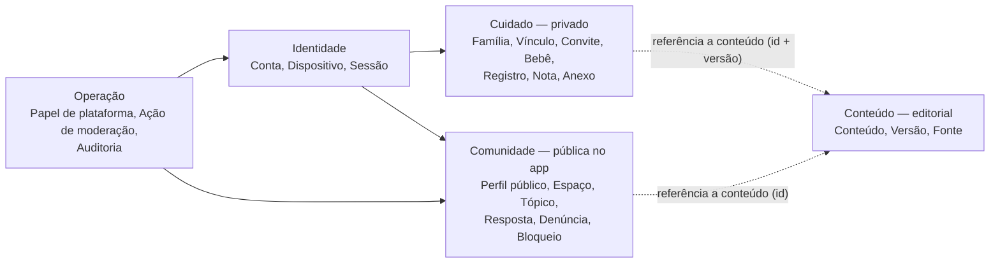
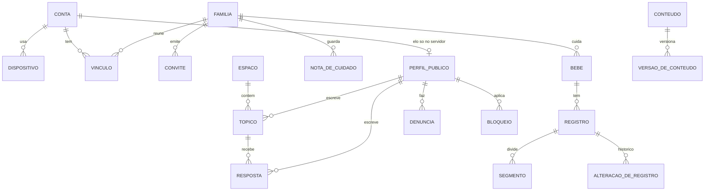

# Data model and permissions

> Note from 03/11/2026: the direction changed to a complete website first and an Android and iOS port afterward ([ADR-009](../06_ADRs/ADR-009_Site_Completo_Primeiro.md)). Wherever this text mentions a native app, read it as the port; the website covers the same functions.

Hermes's proposal, not yet approved by Daniel. The model is logical: it applies to any of the architecture stacks compared in [Architecture comparison](Comparacao_de_Arquiteturas.md). Table names, column types and indexes are left to the implementation.

## 1. Problem

The app stores data about babies recorded by several adults, from several independent families, and at the same time has a community open to people who do not belong to those families. Three risks guide the model:

1. One family reading or changing another family's data, through a query, sync, file or notification.
2. The community becoming a path to a child's private routine.
3. A removed caregiver continuing to write with an old permission stored on the device or in the token.

## 2. Domain boundaries

The model is divided into five contexts. Each has its own owner, rules and logical storage; the arrows show the only references allowed between them.

Boundary rules:

- **Care** and **Community** do not reference each other. No community entity stores a Family, Baby or Record key. When someone shares something from the routine, what goes to the community is a copy of the text the person reviewed and confirmed, with no link back (section 6).
- The link between the Account and the Public profile exists only on the server. Other users and the common moderation screen see only the public profile.
- **Operations** acts on Community and Identity. Moderation has no path to Care data.
- **Content** is read-only for users; records may cite an activity by its id and the version that was read.

## 3. Entities

Legend for the Phase column: **MVP** goes into the first usable version; **Foundation** must already exist in the first technical slice; **Later** is left for expansions.

### 3.1 Identity

| Entity | Main fields | Phase | Notes |
| --- | --- | --- | --- |
| Account | id, login e-mail, private name (seen only by the family), language, preferred time zone, status (active, deletion scheduled, deleted), accepted versions of terms and policy | Foundation | One adult. There is no child account. |
| Device | id, account, platform, app version, push token (encrypted), last contact, session | Foundation | Revoking a device ends its session without affecting the others. |

### 3.2 Care (private)

| Entity | Main fields | Phase | Notes |
| --- | --- | --- | --- |
| Family | id, name, reference time zone (IANA), created by, created at, status | Foundation | "Grupo de cuidado" in the model; the name in the interface is left to language research (see [Flows and screens](../02_Experiencia/Fluxos_e_Telas.md)). |
| Membership | family, account, role, status (active, revoked, left), valid until (optional), granted by, created at, ended at, epoch | Foundation | The "época" goes up with each role change or revocation; the server compares it with the epoch the device knows. |
| Invitation | family, proposed role, created by, code hash, expires at, remaining uses (1), status (pending, accepted, expired, revoked), accepted by, accepted at | Foundation | The plaintext code is shown only to the inviter; the server stores the hash. |
| Baby | id, family, name or nickname, date of birth, status (active, archived), created by | Foundation | Sex, weight and photo are left out of the MVP (minimization). The date of birth is used for age and phase-based content; it never leaves the Care context. |
| Record | id (generated on the device), family, baby, type, status (in progress, completed), start, end, type-specific fields, note, origin (live, retroactive), time zone and offset at the time of recording, started by, ended by, created by, version (from the server), received at, deleted at, deleted by | Foundation | A timed session is an in-progress Record; there is no separate "timer" entity (rationale in section 3.6). |
| Segment | record, side or part, start, end | MVP | Only for breastfeeding (left and right side). Tummy time pauses become separate sessions. |
| Record change | record, operation, author, device, before, after, received at | Foundation | Append-only history. Supports authorship, conflicts and restoration. |
| Care note | id, family, baby (optional), author, text, highlighted until, created at | MVP | Basis of the care handoff ("o que você precisa saber"). |
| Attachment | id, family, record or note, type, size, storage path, created by | Later | Photos and files are left out of the MVP; the model already provides for family scoping. |
| Sync operation | operation id, account, device, family, type, entity, base version, result, processed at | Foundation | Idempotency record on the server (see [Offline and sync](Offline_Sincronizacao_e_Temporizadores.md)). |

Record types in the MVP: sleep (including naps), breastfeeding, bottle, solid food, diaper, tummy time and short observation. Medications, growth measurements, temperature, milk expression and bath remain as expansion candidates; some require additional care with health data.

### 3.3 Content (editorial)

| Entity | Main fields | Phase | Notes |
| --- | --- | --- | --- |
| Content | id, type (article, activity), topic, minimum and maximum age range in weeks, language | MVP | Tummy time activities and age-appropriate play. |
| Content version | content, number, text, authors, credentialed reviewer, sources, license or attribution, reviewed at, next review, status (draft, in review, published, withdrawn) | MVP | Editorial cycle in [Development and content](../04_Comunidade_Conteudo/Desenvolvimento_e_Conteudo.md). |

### 3.4 Community

| Entity | Main fields | Phase | Notes |
| --- | --- | --- | --- |
| Public profile | id, unique nickname, avatar (no child photo by default), short bio, displayed baby age range (optional, chosen by the person), status (active, suspended, banned) | MVP | Linked to the Account only on the server. The displayed range is a choice, not a calculation from the date of birth. |
| Space | id, name, description, specific rules | MVP | Sleep, feeding, bath, tummy time, routine organization, division of care, everyday difficulties. |
| Topic | id, space, author (public profile), title, body, age range (optional tag), status (visible, hidden for review, removed, locked), created at, edited at | MVP | |
| Reply | id, topic, author (public profile), body, reply to (one level), status, created at, edited at | MVP | |
| "ajudou" marking | reply, public profile | Later | No public ranking of people. |
| Report | id, target (topic, reply or profile), reporter, reason, text, status (open, under review, upheld, dismissed), decided by, decision, decided at | MVP | |
| Block | blocker, blocked, created at | MVP | Mutual effect: each stops seeing the other and cannot reply to them. |

### 3.5 Operations

| Entity | Main fields | Phase | Notes |
| --- | --- | --- | --- |
| Platform role | account, role (moderator, support, technical administrator), granted by, valid until | MVP | A role for the product team, separate from family roles. |
| Moderation action | id, moderator, target, action (hide, remove, restore, warn, suspend, ban, lock topic), rule applied, report, deadline, author notified at | MVP | |
| Audit event | who, what, target, when, origin | Foundation | Login, invitation accepted, role change, revocation, export, deletion, administrative actions. No record content. |

### 3.6 Justified boundaries

- **Timed session as an in-progress Record.** Baby Buddy separates the timer from the record and requires a conversion step; Finnberry keeps the timer only in the browser. Here, the session is born as a Record with a start and no end: another caregiver sees and ends the same entity, sync handles a single object, and there is no timer state to reconcile. Details and evidence in the [Baby Buddy](../08_Referencias/Repositorios/Baby_Buddy.md) and [Finnberry](../08_Referencias/Repositorios/Finnberry.md) fact sheets.
- **Short observation as a Record type and Care note as an entity.** An observation tied to a moment ("arrotou pouco") goes into the timeline; a handoff note ("pomada só à noite") has a highlight and validity period and appears at the top for whoever takes over care.
- **No "atividade feita" entity in the MVP.** Doing a suggested activity can become a tummy time session with a reference to the content; a dedicated table only if there is demonstrated use.
- **Attachments outside the MVP.** They reduce the volume of sensitive data and the storage cost while the core is validated.

## 4. Logical diagram

## 5. Roles and permission matrix

### 5.1 Family roles

| Role | For whom | Summary |
| --- | --- | --- |
| Guardian | Mother, father or other legal guardian | Manages the family, babies, invitations and data. There may be more than one. |
| Caregiver | Grandparent, nanny, other trusted adult | Records and follows along. Edits and deletes only what they themselves created, and can end any in-progress session. |
| Observer | Someone who only follows along | Reads records and notes; does not write. |

Any membership can have a validity period ("cuidador até domingo"). Once it expires, the membership behaves as revoked.

### 5.2 Platform roles

Moderator, support and technical administrator are product-team roles. None of them grants read access to care data. Support sees care data only if the family itself requests and authorizes it in the specific case, with an audit record; this procedure is proposed for legal validation in [Privacy and security](../05_Privacidade_Operacao/Privacidade_e_Seguranca.md).

### 5.3 Matrix

Legend: ✔ allowed; ✖ denied; "próprio" only on what the person created.

| Action | Guardian | Caregiver | Observer | Former member or expired membership | Community-only user | Moderator | Support |
| --- | --- | --- | --- | --- | --- | --- | --- |
| View the baby's records and notes | ✔ | ✔ | ✔ | ✖ | ✖ | ✖ | ✖ (only with the family's authorization in the case) |
| Create record or note | ✔ | ✔ | ✖ | ✖ | ✖ | ✖ | ✖ |
| Start or end an in-progress session | ✔ | ✔ (any session) | ✖ | ✖ | ✖ | ✖ | ✖ |
| Edit record | ✔ | own | ✖ | ✖ | ✖ | ✖ | ✖ |
| Delete record | ✔ | own | ✖ | ✖ | ✖ | ✖ | ✖ |
| Restore deleted record (up to 30 days) | ✔ | own | ✖ | ✖ | ✖ | ✖ | ✖ |
| View change history | ✔ | ✔ | ✖ | ✖ | ✖ | ✖ | ✖ |
| Add, edit or archive baby | ✔ | ✖ | ✖ | ✖ | ✖ | ✖ | ✖ |
| Invite, revoke and change role | ✔ | ✖ | ✖ | ✖ | ✖ | ✖ | ✖ |
| Leave the family | ✔ (if not the last guardian) | ✔ | ✔ | — | — | — | — |
| Export family data | ✔ | ✖ | ✖ | ✖ | ✖ | ✖ | ✖ |
| Delete the family | ✔ | ✖ | ✖ | ✖ | ✖ | ✖ | ✖ |
| Post, reply, report and block in the community | ✔ | ✔ | ✔ | ✔ | ✔ | ✔ | ✔ |
| View report queue and moderate | ✖ | ✖ | ✖ | ✖ | ✖ | ✔ | ✖ |
| View an author's e-mail or account data | ✖ | ✖ | ✖ | ✖ | ✖ | ✖ (only the public profile) | ✔ (with a recorded reason) |

The community is open to any account, with or without a family. Having a family changes nothing in the community, and participating in the community changes nothing in the family.

## 6. Invariants

The server enforces the rules below on every operation, including those arriving through sync. Tests for each one are planned in [Quality and validation](../05_Privacidade_Operacao/Qualidade_e_Validacao.md).

1. **Authorization by current membership.** Every operation on Care data is authorized based on the membership in effect in the database at the moment it arrives (status, role, validity and epoch). The token proves only who the person is and which device it is; a list of families stored in the token never authorizes a write.
2. **Scope consistency.** Every Record, Note and Attachment belongs to the same family as the baby it references. An id from another family is treated as nonexistent: the response is the same as for an id that does not exist, without confirming that it belongs to someone.
3. **At least one guardian.** Every active family has an active guardian. The last guardian can only leave after transferring the role or deleting the family.
4. **Community with no path to the routine.** No community query joins Care tables. Public profiles do not carry date of birth, baby name or family.
5. **Moderation without reading children's data.** Platform roles do not grant read access to Care.
6. **Server fields.** Version, "recebido em", confirmed authorship and operation result are set by the server. The device proposes; the server confirms.
7. **Traceable deletion.** A deleted record becomes a syncable deletion marker; the data is permanently erased after the restoration period, except for account or family deletion, which brings the purge forward (time limits in [Privacy and security](../05_Privacidade_Operacao/Privacidade_e_Seguranca.md)).
8. **Non-sequential identifiers.** Ids generated on the device, unique and time-ordered (UUIDv7 or equivalent); never counters that would allow guessing other families' ids.
9. **Notifications only for active memberships.** A push about a family goes only to devices of accounts with an active membership in it, and the push text contains no sensitive data.
10. **Files by scope.** When there are attachments, they are kept under a family prefix and delivered only via a short-lived URL issued after the membership check. Community media is kept in a separate area, without location metadata.

## 7. Data classification

| Class | Examples | Handling |
| --- | --- | --- |
| Sensitive (hypothesis: child health data) | Care records, notes, date of birth, future attachments | Only in the Care context; encryption in transit and at rest; kept out of logs, analytics and pushes. The legal classification is open in [Privacy and security](../05_Privacidade_Operacao/Privacidade_e_Seguranca.md). |
| Personal | E-mail, private name, push tokens, access IPs | Minimum necessary; defined retention; kept out of public content. |
| Public in the app | Topics, replies and public profiles | Visible to any account; moderated; subject to reports. |
| Editorial | Content items and versions | Public; with authorship, source and license. |

## 8. Alternatives considered

| Alternative | Why it was not proposed |
| --- | --- |
| Per-model permission, as in Baby Buddy's default Django | Answers "esta pessoa pode editar registros de sono?", not "pode editar os desta família?". In a product with several families, family scoping must come before the data type. |
| List of families in the token as authorization | Goes stale until the token is renewed; a revoked caregiver would keep writing. The Supabase documentation warns about this (source B05 in the package). |
| A single account with public and private profile combined | Simpler, but exposes the family when someone clicks on a post's author. |
| Timer as an entity separate from the record | Duplicates state and requires conversion; see section 3.6. |
| Free editing of any record by any caregiver | Simpler for couples, risky for temporary caregivers. The proposal gives this power to the Guardian role, which can be given to both parents. |

## 9. Consequences

- Positive: explicit family scoping in every operation; community isolated by construction; effective revocation on the server; authorship and history available to resolve conflicts.
- Negative: two identities per person (account and public profile) require explanation in the interface; the change history grows and needs retention; checking the membership on every operation has a query cost, to be measured in the technical proof (MAT-17).

## Open questions

1. Name of the group in the interface: "Família", "Rede de cuidado" or something else (user research).
2. Can a baby belong to two families (separated parents with distinct groups)? The proposal is no in the MVP: a single group, with both guardians.
3. Should the Observer have a history limit (for example, the last 7 days)?
4. Restoration period for a deleted record: 30 days is a proposal.
5. Legal classification of records as health data: depends on professional validation.

## Limits of this analysis

Logical model with no implementation or testing. The claims about the references are supported by the fact sheets in `08_Referencias/Repositorios/`; the authorization rules and invariants will be proven in the technical proof (MAT-17) and in the first slice (MAT-18).
