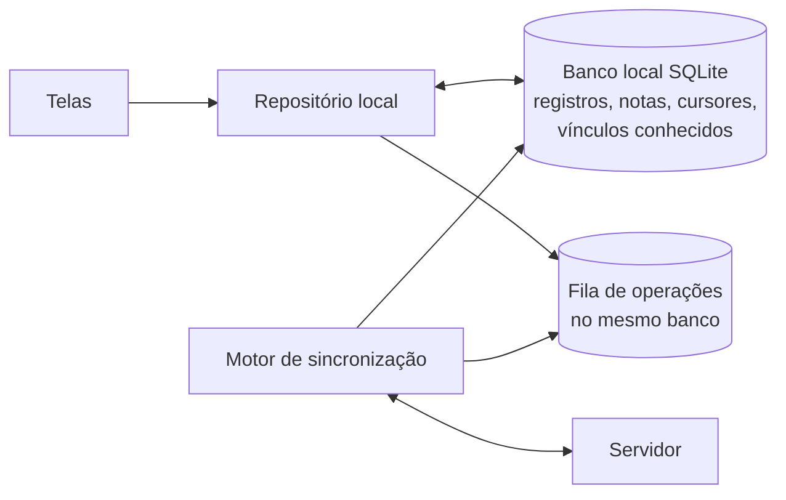

# Offline, sincronização e temporizadores

> Nota de 03/11/2026: o rumo mudou para site completo primeiro e port Android e iOS depois ([ADR-009](../06_ADRs/ADR-009_Site_Completo_Primeiro.md)). Onde este texto fala em app nativo, leia como o port; o site cobre as mesmas funções.

Proposta do Hermes, ainda não aprovada por Daniel. Este documento define o comportamento esperado, independente da tecnologia. Como cada conjunto de arquitetura o implementa está na seção 14 e em [Comparação de arquiteturas](Comparacao_de_Arquiteturas.md). Entidades e papéis vêm de [Modelo de dados e permissões](Modelo_de_Dados_e_Permissoes.md).

## 1. Problema

Cuidadores registram de madrugada, no colo, com sinal ruim ou sem sinal. Um registro perdido, duplicado ou alterado sem aviso destrói a confiança no aplicativo. Ao mesmo tempo, vários adultos escrevem sobre o mesmo bebê, às vezes sem conexão, e um deles pode perder o acesso enquanto está offline. "Ter offline" não basta: é preciso dizer o que funciona sem rede, onde fica guardado, como chega ao servidor, quando a permissão é conferida de novo e o que a pessoa vê quando algo dá errado.

## 2. Alcance do modo offline

| Ação | Sem conexão | Observação |
| --- | --- | --- |
| Ver Hoje, histórico recente e sessões em andamento | Sim | Com os dados já guardados no aparelho. Proposta: últimos 90 dias de registros; períodos mais antigos são buscados quando houver rede. |
| Registrar (todos os tipos do MVP), iniciar e encerrar sessão | Sim | Grava no aparelho e entra na fila de envio. |
| Corrigir ou excluir registro permitido pelo papel | Sim | Idem; pode gerar conflito (seção 7). |
| Escrever nota de passagem de cuidados | Sim | Idem. |
| Ler conteúdo de desenvolvimento da fase atual | Sim | Pacote versionado baixado com antecedência. |
| Criar família, cadastrar bebê | Não no MVP | Ação rara; exige servidor para criar o vínculo de responsável. |
| Convidar, aceitar convite, mudar papel, revogar | Não | Ações de segurança: só valem confirmadas pelo servidor. |
| Comunidade | Leitura do que já foi aberto; escrita vira rascunho | Publicar exige conexão: a moderação e as regras de bloqueio são do servidor. |
| Exportar dados, excluir conta | Não | |

## 3. Arquitetura no aparelho

- A interface lê sempre do banco local. Nenhuma tela espera a rede para mostrar um registro recém-feito.
- Cada ação do usuário grava, numa única transação, a mudança local e uma operação na fila. Se o app for encerrado logo depois, as duas coisas estão no disco ou nenhuma está.
- O motor de sincronização envia a fila quando há rede e baixa mudanças das famílias em que a pessoa tem vínculo ativo.

## 4. A operação

Cada intenção do usuário vira uma operação com:

| Campo | Para quê |
| --- | --- |
| id da operação | Gerado no aparelho (UUIDv7 ou equivalente). Garante que reenviar não duplica. |
| tipo | iniciar sessão, encerrar sessão, criar registro, atualizar registro, excluir registro, restaurar registro, criar nota. |
| entidade, família, bebê | Escopo conferido pelo servidor. |
| versão-base | A versão do registro que o aparelho conhecia ao editar. Detecta edição sobre dado velho. |
| campos | Só os campos alterados. |
| autor e dispositivo | Autoria; o servidor confirma que batem com a sessão autenticada. |
| instante local, fuso IANA e deslocamento | Quando a pessoa agiu, segundo o aparelho. |
| relógio monotônico (sessões ao vivo) | Detecta troca manual do relógio durante uma sessão (seção 9). |
| sequência local | Ordem das operações daquele aparelho. |

## 5. Envio e confirmação

1. O aparelho envia operações em lote, na ordem da sequência local.
2. O servidor procura o id da operação. Se já foi processada, devolve o mesmo resultado de antes e não aplica de novo.
3. Confere a identidade da sessão e o vínculo atual na família (estado, papel, validade, época). Sem vínculo válido, rejeita.
4. Valida o conteúdo (tipos, limites, fim depois do início, bebê da mesma família).
5. Compara a versão-base com a versão atual e aplica a política de conflito (seção 7).
6. Aplica, sobe a versão do registro, grava "recebido em" e a entrada no histórico de alterações, e acrescenta a mudança ao fluxo da família.
7. Devolve um resultado por operação: aplicada, aplicada com mescla, já processada, conflito ou rejeitada (com motivo: sem permissão, vínculo revogado, validação, registro excluído).

Reenvio: depois de timeout ou queda, o aparelho reenvia a mesma operação com o mesmo id. Operações que dependem de uma rejeitada (por exemplo, editar um registro cuja criação foi recusada) também são recusadas, com o mesmo motivo.

## 6. Recebimento

- O servidor mantém, por família, uma sequência crescente de mudanças, incluindo marcas de exclusão. O aparelho pede "mudanças desde o cursor N" para cada família em que tem vínculo ativo.
- Antes de responder, o servidor confere o vínculo atual. Se ele foi revogado, a resposta é "acesso encerrado" e o aparelho apaga os dados locais daquela família (seção 11).
- Um canal em tempo real, se existir, só avisa que há mudança; quem traz o dado é o pedido de mudanças. Perder um aviso não perde dado.

## 7. Estados visíveis e conflitos

### 7.1 Estado de cada registro

| Estado | O que significa | O que a pessoa vê |
| --- | --- | --- |
| Salvo no aparelho | Gravado localmente, ainda não enviado | Marca discreta "aguardando envio" |
| Enviando | Em envio | A mesma marca, animada |
| Sincronizado | Confirmado pelo servidor | Sem marca |
| Precisa de revisão | Conflito de edição | Selo e as duas versões, com autor e horário |
| Não enviado | Rejeitado pelo servidor | Motivo e ações: descartar ou copiar o texto |

No topo do app: "Sem conexão. 3 registros aguardando envio" e "Atualizado às 03:12".

### 7.2 Política por caso

| Caso | Política | O que a pessoa vê |
| --- | --- | --- |
| Reenvio da mesma operação | Idempotência pelo id da operação | Nada; um registro só |
| Duas pessoas registram o mesmo evento (por exemplo, a mesma troca de fralda) | Não é conflito técnico: os ids são diferentes | Aviso "possível duplicado" quando há mesmo tipo, mesmo bebê, autores diferentes e até 10 minutos de distância; ações "manter os dois" ou "excluir este" |
| Edições em campos diferentes do mesmo registro | Mescla por campo | Nada; o histórico mostra os dois autores |
| Edições no mesmo campo com versão-base antiga | Vale a primeira que chegou ao servidor; a segunda fica guardada como proposta pendente | Registro com selo "precisa de revisão", mostrando as duas versões; qualquer pessoa com permissão de edição escolhe. Nada some sem decisão. |
| Exclusão chega depois de uma edição | A exclusão vale; a edição fica no histórico | Quem editou recebe "excluído por B; sua alteração ficou no histórico" e, se puder, restaura |
| Edição chega depois de uma exclusão | Rejeitada como "registro excluído" | Opção de restaurar (se o papel permitir) e reaplicar a edição |
| Dois encerramentos da mesma sessão | Vale o primeiro; se o segundo tiver fim até 2 minutos diferente, é duplicado sem efeito; se a diferença for maior, vira conflito no campo "fim" | Normalmente nada; no conflito, o selo de revisão |
| Duas sessões do mesmo tipo iniciadas em paralelo para o mesmo bebê | O servidor aceita as duas (não há como impedir offline) | "Duas sessões de sono em andamento", com ações "unir" (mantém o início mais cedo) ou "encerrar uma" |
| Operação de quem perdeu o acesso | Rejeitada | "Não enviado: seu acesso a esta família foi encerrado" |

O último-que-escreve-vence puro foi descartado para campos de horário e quantidade porque apagaria, sem aviso, a correção de um dos cuidadores.

### 7.3 Ordem e relógios divergentes

- A ordem de aplicação é a ordem de chegada ao servidor, dentro de cada família. A ordem de exibição é o início observado do registro.
- O servidor nunca reescreve horários informados pela pessoa. Ele compara o relógio do aparelho com o próprio em cada sincronização; acima de 2 minutos de diferença, o app avisa que o relógio do aparelho parece adiantado ou atrasado.
- Registro com início mais de 5 minutos no futuro, segundo o servidor, recebe marca "horário a conferir", sem bloqueio.

## 8. Tempo, fuso e meia-noite

- Instantes ficam em UTC, junto com o fuso IANA e o deslocamento do aparelho no momento do registro.
- Durações saem sempre da diferença entre instantes UTC; horário de verão e troca de fuso não alteram a duração.
- A família tem um fuso de referência (por padrão, o de quem a criou). "Hoje" e os totais do dia usam esse fuso, para que todos vejam o mesmo dia. Os horários aparecem no fuso atual do aparelho; quando ele difere do fuso da família, a tela avisa.
- Uma sessão que atravessa a meia-noite aparece no dia em que começou, com a marca "termina no dia seguinte". Os totais diários repartem a duração entre os dois dias.
- Registro retroativo: início e fim escolhidos pela pessoa, com origem "retroativo". Fim antes do início é recusado; durações acima de um limite por tipo (por exemplo, sono acima de 16 horas ou tummy time acima de 1 hora) pedem confirmação, sem bloquear.
- Sobreposição de sessões do mesmo tipo gera aviso, não bloqueio: a pessoa pode estar corrigindo um registro antigo.

## 9. Temporizadores

Princípio: o tempo decorrido é calculado a partir do início gravado; a tela só redesenha. Nada precisa ficar rodando em segundo plano.

1. **Iniciar.** O app grava o Registro em andamento e a operação antes de mostrar o cronômetro.
2. **Tela bloqueada, app suspenso ou encerrado.** Nenhum contador roda. Ao reabrir, o app lê os registros em andamento e calcula o tempo a partir do início.
3. **Troca manual do relógio.** O app guarda também uma leitura do relógio monotônico do sistema no início da sessão. Se, no mesmo ciclo de energia, as duas medidas divergirem mais de 1 minuto, a tela pede para conferir o horário. Reiniciar o aparelho zera o relógio monotônico; aí vale só o instante gravado.
4. **Fora do app.** Android pode mostrar uma notificação contínua com cronômetro desenhado pelo sistema; iOS pode mostrar uma Live Activity. As duas partem do instante de início e não dependem de o app estar rodando. São melhorias que exigem código nativo; o custo por alternativa está em [Mobile e plataformas](../08_Referencias/Tecnologias/Mobile_e_Plataformas.md).
5. **Sessão esquecida.** Acima do limite do tipo, ao abrir o app a pessoa vê "Ainda em andamento?" e pode encerrar escolhendo o horário real.
6. **Lembrete.** Opcional, por notificação local, desligado por padrão, sem tom de cobrança.
7. **Outro cuidador encerra.** Qualquer Responsável ou Cuidador encerra uma sessão em andamento; "iniciado por" e "encerrado por" ficam registrados. Concorrência na seção 7.

## 10. Notificação local, push e sincronização

| Mecanismo | Serve para | Depende de | Se falhar ou for negado |
| --- | --- | --- | --- |
| Notificação local | Lembretes agendados no próprio aparelho | Permissão de notificação | O app funciona igual; o lembrete não aparece |
| Push remoto | Avisar outro cuidador (opcional) e sugerir uma sincronização | Permissão, FCM/APNs e rede | A sincronização acontece ao abrir o app ou quando o sistema permitir |
| Sincronização | Transferir os dados | Rede | A fila espera; nada se perde |

Push nunca é condição para os dados ficarem corretos. O texto padrão não traz dado sensível nem nome do bebê na tela bloqueada ("Há uma atualização na rotina"); detalhes só dentro do app. Tarefas periódicas em segundo plano não têm horário garantido pelos sistemas (fonte M08 do pacote) e servem só como oportunidade extra de sincronizar.

## 11. Revogação e limites honestos

No servidor, a revogação é imediata: o vínculo vira "revogado", a época sobe, operações daquela conta para a família passam a ser recusadas, o fluxo de mudanças para de entregar dados da família e os pushes param.

No aparelho que estava offline:

1. Enquanto não reconecta, o app continua mostrando os dados guardados e aceita novos registros na fila: ele não sabe da revogação.
2. Ao reconectar, a primeira resposta do servidor é "acesso encerrado". O app apaga os dados locais daquela família (registros, notas, cache de arquivos e operações pendentes) e mostra quantas operações não foram enviadas.
3. As operações não enviadas são descartadas; os dados pertencem à família, e quem saiu não pode exportá-los.

Limites que o produto não deve esconder:

- Revogação remota não apaga na hora o que já foi visto ou guardado num aparelho desconectado, nem o que alguém copiou ou fotografou.
- Mitigações propostas: janela local de 90 dias; uma "licença de acesso" de 14 dias por aparelho e família, renovada a cada sincronização (vencida, o app esconde os dados da família até conseguir revalidar); armazenamento cifrado pelo sistema operacional e, se a prova técnica mostrar custo aceitável, banco local cifrado. Um aparelho com root ou jailbreak ainda pode extrair o que já estava no disco.
- A mensagem ao responsável que revoga diz isso em linguagem simples.

## 12. Exclusão propagada

| O que é excluído | Efeito |
| --- | --- |
| Registro | Marca de exclusão sincronizada; os aparelhos removem a cópia local. Restauração possível por 30 dias; depois, expurgo. |
| Bebê | Arquivar esconde e preserva. Excluir propaga marcas para todos os registros dele; aparelhos removem; expurgo depois do prazo. |
| Família | Todos os membros recebem "família excluída" e apagam os dados locais. Proposta: 7 dias para desfazer, depois expurgo. |
| Conta | Encerra os vínculos; se a pessoa for a última responsável, precisa transferir o papel ou excluir a família antes. O tratamento das postagens na comunidade está em [Privacidade e segurança](../05_Privacidade_Operacao/Privacidade_e_Seguranca.md). |

Backups seguem o ciclo próprio de retenção; a exclusão só se completa neles quando a cópia expira. Prazos e redação para o usuário estão no documento de privacidade.

## 13. Cinco situações de ponta a ponta

### S1. Registro offline, app encerrado, reabertura e envio sem perda nem duplicação (Q-01, Q-02, Q-08)

1. Sem rede, Ana inicia uma sessão de tummy time. O app grava o Registro em andamento e a operação "iniciar sessão" na mesma transação.
2. Ana bloqueia a tela; o sistema encerra o app.
3. Ana reabre. O app lê o Registro em andamento e mostra o tempo calculado a partir do início. Ela encerra: nova operação "encerrar sessão" na fila.
4. A rede volta. O motor envia as duas operações. A resposta do servidor se perde.
5. O app reenvia as mesmas duas operações. O servidor reconhece os ids e devolve "já processada".
6. Resultado esperado: um registro, com início e fim corretos, estado "sincronizado". Evidência na prova: contagem de registros no servidor igual a 1, tabela de idempotência com as duas operações, captura da tela antes e depois.

### S2. Um cuidador inicia, outro encerra; os dois editam (Q-03, Q-04)

1. Bruno inicia a soneca às 14:00 e sincroniza.
2. Carla vê a sessão em andamento no aparelho dela e encerra às 15:10. "Encerrado por Carla."
3. Offline, Bruno corrige o início para 13:55; Carla, também offline, corrige para 14:05. As duas edições partem da mesma versão-base.
4. A edição de Bruno chega primeiro e é aplicada. A de Carla chega com versão-base antiga no mesmo campo e vira proposta pendente.
5. Os dois veem o selo "precisa de revisão" com as duas versões, autores e horários; um deles escolhe. O histórico guarda as três versões.

### S3. Vínculo revogado com um aparelho offline (Q-05)

1. A babá Dora (Cuidadora) está offline no metrô e registra duas fraldas.
2. O responsável revoga o vínculo de Dora. No servidor, a época sobe e o vínculo fica revogado.
3. Dora reconecta. O pedido de mudanças responde "acesso encerrado"; o envio das duas operações é recusado com o mesmo motivo.
4. O app de Dora apaga os dados da família e mostra "2 registros não foram enviados porque seu acesso foi encerrado".
5. A família não recebe esses registros. Se a licença de 14 dias tivesse vencido antes da reconexão, o app já teria escondido os dados.

### S4. Duas famílias ao mesmo tempo, com anexos e notificações (Q-06, Q-10)

1. As famílias X e Y sincronizam em paralelo.
2. Um cliente modificado da família X envia operações com o id de um registro de Y e pede mudanças de Y. O servidor responde como se os ids não existissem.
3. Quando houver anexos, um pedido de URL de arquivo de Y por alguém de X é recusado antes de qualquer URL ser emitida; URLs expiram em minutos.
4. Um push sobre Y só vai para dispositivos com vínculo ativo em Y. Se alguém de X negou notificações, nada muda para X além de não receber avisos.
5. Evidência na prova: testes automatizados de autorização por id de outra família em cada rota e canal, e conferência dos destinatários de push num ambiente de teste.

### S5. Publicar na comunidade sem expor a rotina (Q-07)

1. Elisa abre o espaço "Sono" e escreve um tópico. O autor é o perfil público dela; nada da família vai junto.
2. Ela toca em "incluir um resumo da minha semana". O app monta, no aparelho, um texto com as médias que ela escolher e mostra a prévia exata do que será publicado; nada sai sem a confirmação dela.
3. Publicado, o tópico guarda só o texto confirmado, sem referência a bebê, família ou registros.
4. Outra pessoa abre o perfil público de Elisa e vê apelido, bio e a faixa de idade que ela escolheu mostrar. Não há caminho para a rotina.
5. Um moderador que avalia uma denúncia sobre o tópico vê o tópico e o perfil público; não vê a família.

## 14. Como cada conjunto de arquitetura implementa o protocolo

Resumo; a comparação completa, com versões e fontes, está em [Comparação de arquiteturas](Comparacao_de_Arquiteturas.md).

| Parte do protocolo | A. Firebase (Firestore) | B. PostgreSQL gerenciado + camada de sync | C. API própria + PostgreSQL |
| --- | --- | --- | --- |
| Banco local | Cache do SDK nativo (Android, Apple ou Flutter); no React Native, depende de usar o SDK nativo (React Native Firebase) e não o SDK JavaScript | SQLite gerenciado pela biblioteca de sync | SQLite com fila própria |
| Fila e idempotência | Gravações pendentes do SDK; id do documento gerado no aparelho dá idempotência na criação; operações de domínio exigem uma coleção de operações processada por funções no servidor | Fila de envio da biblioteca; o backend aplica as operações e guarda o id | Construídas pelo projeto |
| Conflito explícito | Não nativo (última escrita vence por campo); exige funções no servidor | Implementado nas funções do backend que recebem o envio | Implementado no serviço |
| Autorização pelo vínculo atual | Regras de segurança consultando o documento de vínculo; caminhos de servidor precisam da própria checagem | Políticas no banco e checagem nas funções; regras de download filtram por vínculo | Checagem no serviço em toda rota |
| Revogação e limpeza local | Escrita recusada pelas regras é desfeita no cache; a limpeza da família no aparelho é código do app | Dados fora das regras de download saem do aparelho; a confirmar na prova | Código do app ao receber "acesso encerrado" |

## 15. Alternativas consideradas

| Alternativa | Por que não |
| --- | --- |
| Só online | Viola o requisito de registrar sem conexão. |
| Último que escreve vence em tudo | Apaga correções sem aviso em horários e quantidades. |
| CRDT completo | Complexidade desproporcional: poucos campos editados em paralelo, e a revisão humana é aceitável nesses casos raros. |
| Só quem iniciou pode encerrar a sessão | Quebra a troca de turno entre cuidadores, que é o centro do pilar de cuidado compartilhado. |
| Contador rodando em segundo plano | Os sistemas não garantem execução contínua; a duração seria perdida ao encerrar o app. |

## Questões abertas

1. Janela local de 90 dias e licença de 14 dias: valores a validar com uso real e na prova técnica.
2. Tolerância de 2 minutos para encerramento duplicado.
3. Texto e granularidade dos pushes entre cuidadores (o que avisar e quando).
4. Banco local cifrado: custo de desempenho e de build a medir na prova.
5. Escrita offline na comunidade além de rascunho: proposta é não.

## Limites desta análise

Especificação sem implementação. Os cenários S1 a S5 são requisitos de teste para a prova técnica (MAT-17) e para a primeira fatia (MAT-18), não resultados de teste.
