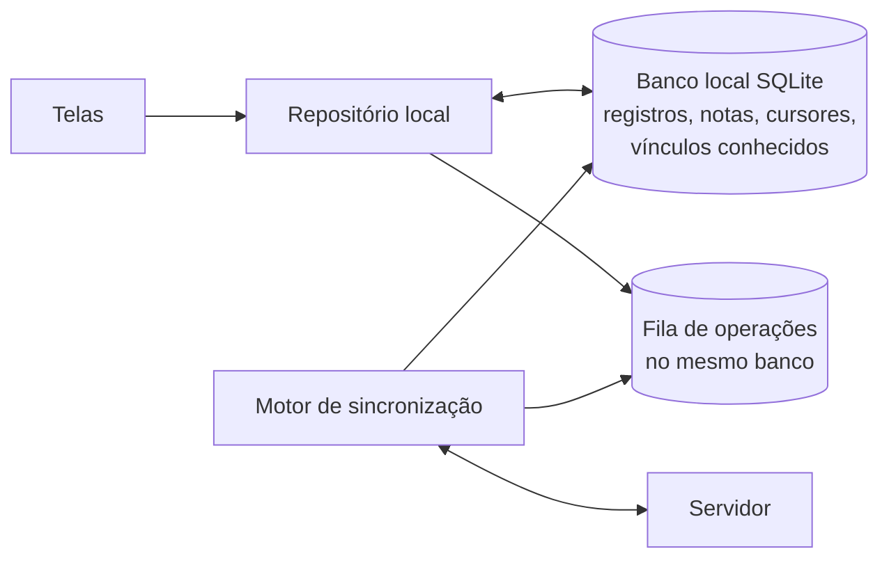

# Offline, sync, and timers

> Note from 03/11/2026: the direction changed to the full website first and the Android and iOS port afterward ([ADR-009](../06_ADRs/ADR-009_Site_Completo_Primeiro.md)). Where this text mentions a native app, read it as the port; the website covers the same functions.

Hermes's proposal, not yet approved by Daniel. This document defines the expected behavior, independent of technology. How each architecture stack implements it is in section 14 and in [Architecture comparison](Comparacao_de_Arquiteturas.md). Entities and roles come from [Data model and permissions](Modelo_de_Dados_e_Permissoes.md).

## 1. Problem

Caregivers log records in the middle of the night, with the baby in their lap, with poor signal or no signal. A lost, duplicated, or silently altered record destroys trust in the app. At the same time, several adults write about the same baby, sometimes without a connection, and one of them may lose access while offline. "Ter offline" is not enough: it is necessary to state what works without a network, where it is stored, how it reaches the server, when permission is checked again, and what the person sees when something goes wrong.

## 2. Scope of offline mode

| Action | Without connection | Note |
| --- | --- | --- |
| View Hoje, recent history, and sessions in progress | Yes | Using the data already stored on the device. Proposal: last 90 days of records; older periods are fetched when there is a network connection. |
| Log (all MVP types), start and end a session | Yes | Writes to the device and enters the send queue. |
| Correct or delete a record as permitted by the role | Yes | Same; may generate a conflict (section 7). |
| Write a care handoff note | Yes | Same. |
| Read development content for the current phase | Yes | Versioned package downloaded in advance. |
| Create a family, register a baby | Not in the MVP | Rare action; requires the server to create the guardian membership. |
| Invite, accept an invitation, change role, revoke | No | Security actions: they only take effect once confirmed by the server. |
| Community | Reading what has already been opened; writing becomes a draft | Publishing requires a connection: moderation and blocking rules belong to the server. |
| Export data, delete account | No | |

## 3. On-device architecture

- The interface always reads from the local database. No screen waits for the network to show a just-created record.
- Each user action writes, in a single transaction, the local change and an operation in the queue. If the app is closed right afterward, either both are on disk or neither is.
- The sync engine sends the queue when there is a network connection and downloads changes from the families in which the person has an active membership.

## 4. The operation

Each user intent becomes an operation with:

| Field | Purpose |
| --- | --- |
| operation id | Generated on the device (UUIDv7 or equivalent). Ensures that resending does not duplicate. |
| type | start session, end session, create record, update record, delete record, restore record, create note. |
| entity, family, baby | Scope checked by the server. |
| base version | The version of the record the device knew when editing. Detects editing over stale data. |
| fields | Only the changed fields. |
| author and device | Authorship; the server confirms they match the authenticated session. |
| local instant, IANA time zone, and offset | When the person acted, according to the device. |
| monotonic clock (live sessions) | Detects a manual clock change during a session (section 9). |
| local sequence | Order of that device's operations. |

## 5. Sending and confirmation

1. The device sends operations in batches, in local sequence order.
2. The server looks up the operation id. If it has already been processed, it returns the same result as before and does not apply it again.
3. It checks the session identity and the current membership in the family (state, role, validity, epoch). Without a valid membership, it rejects.
4. It validates the content (types, limits, end after start, baby from the same family).
5. It compares the base version with the current version and applies the conflict policy (section 7).
6. It applies, bumps the record version, writes "recebido em" and the entry in the change history, and appends the change to the family's stream.
7. It returns one result per operation: applied, applied with merge, already processed, conflict, or rejected (with a reason: no permission, membership revoked, validation, record deleted).

Resending: after a timeout or dropped connection, the device resends the same operation with the same id. Operations that depend on a rejected one (for example, editing a record whose creation was refused) are also refused, with the same reason.

## 6. Receiving

- The server maintains, per family, an increasing sequence of changes, including deletion markers. The device requests "mudanças desde o cursor N" for each family in which it has an active membership.
- Before responding, the server checks the current membership. If it has been revoked, the response is "acesso encerrado" and the device deletes that family's local data (section 11).
- A real-time channel, if one exists, only signals that there is a change; the data is brought by the change request. Losing a signal does not lose data.

## 7. Visible states and conflicts

### 7.1 State of each record

| State | What it means | What the person sees |
| --- | --- | --- |
| Saved on device | Stored locally, not yet sent | Discreet mark "aguardando envio" |
| Sending | Being sent | The same mark, animated |
| Synced | Confirmed by the server | No mark |
| Needs review | Edit conflict | Badge and both versions, with author and time |
| Not sent | Rejected by the server | Reason and actions: discard or copy the text |

At the top of the app: "Sem conexão. 3 registros aguardando envio" and "Atualizado às 03:12".

### 7.2 Policy by case

| Case | Policy | What the person sees |
| --- | --- | --- |
| Resend of the same operation | Idempotency via the operation id | Nothing; just one record |
| Two people log the same event (for example, the same diaper change) | Not a technical conflict: the ids are different | Warning "possível duplicado" when there is the same type, same baby, different authors, and up to 10 minutes apart; actions "manter os dois" or "excluir este" |
| Edits to different fields of the same record | Per-field merge | Nothing; the history shows both authors |
| Edits to the same field with an old base version | The first one to reach the server wins; the second is kept as a pending proposal | Record with badge "precisa de revisão", showing both versions; anyone with edit permission chooses. Nothing disappears without a decision. |
| Deletion arrives after an edit | The deletion stands; the edit remains in the history | Whoever edited receives "excluído por B; sua alteração ficou no histórico" and, if permitted, restores |
| Edit arrives after a deletion | Rejected as "registro excluído" | Option to restore (if the role permits) and reapply the edit |
| Two endings of the same session | The first one wins; if the second has an end time up to 2 minutes different, it is a duplicate with no effect; if the difference is larger, it becomes a conflict on the field "fim" | Normally nothing; in a conflict, the review badge |
| Two sessions of the same type started in parallel for the same baby | The server accepts both (there is no way to prevent it offline) | "Duas sessões de sono em andamento", with actions "unir" (keeps the earlier start) or "encerrar uma" |
| Operation from someone who lost access | Rejected | "Não enviado: seu acesso a esta família foi encerrado" |

Pure last-writer-wins was ruled out for time and quantity fields because it would silently erase one of the caregivers' corrections.

### 7.3 Order and divergent clocks

- The order of application is the order of arrival at the server, within each family. The display order is the record's observed start.
- The server never rewrites times entered by the person. It compares the device's clock with its own on each sync; above 2 minutes of difference, the app warns that the device's clock seems to be fast or slow.
- A record with a start more than 5 minutes in the future, according to the server, receives the mark "horário a conferir", without blocking.

## 8. Time, time zone, and midnight

- Instants are stored in UTC, along with the device's IANA time zone and offset at the moment of the record.
- Durations are always derived from the difference between UTC instants; daylight saving time and time zone changes do not alter the duration.
- The family has a reference time zone (by default, that of whoever created it). "Hoje" and the daily totals use that time zone, so that everyone sees the same day. Times are shown in the device's current time zone; when it differs from the family's time zone, the screen warns.
- A session that crosses midnight appears on the day it started, with the mark "termina no dia seguinte". Daily totals split the duration between the two days.
- Retroactive record: start and end chosen by the person, with origin "retroativo". An end before the start is refused; durations above a per-type limit (for example, sleep above 16 hours or tummy time above 1 hour) ask for confirmation, without blocking.
- Overlapping sessions of the same type generate a warning, not a block: the person may be correcting an old record.

## 9. Timers

Principle: elapsed time is calculated from the recorded start; the screen only redraws. Nothing needs to keep running in the background.

1. **Start.** The app writes the in-progress Record and the operation before showing the stopwatch.
2. **Screen locked, app suspended or closed.** No counter runs. On reopening, the app reads the in-progress records and calculates the time from the start.
3. **Manual clock change.** The app also stores a reading of the system's monotonic clock at the start of the session. If, within the same power cycle, the two measurements diverge by more than 1 minute, the screen asks to check the time. Restarting the device resets the monotonic clock; in that case only the recorded instant counts.
4. **Outside the app.** Android can show an ongoing notification with a system-drawn chronometer; iOS can show a Live Activity. Both start from the start instant and do not depend on the app running. These are enhancements that require native code; the cost per alternative is in [Mobile and platforms](../08_Referencias/Tecnologias/Mobile_e_Plataformas.md).
5. **Forgotten session.** Above the type's limit, when opening the app the person sees "Ainda em andamento?" and can end it by choosing the actual time.
6. **Reminder.** Optional, via local notification, off by default, without a nagging tone.
7. **Another caregiver ends it.** Any Guardian or Caregiver can end a session in progress; "iniciado por" and "encerrado por" are recorded. Concurrency in section 7.

## 10. Local notification, push, and sync

| Mechanism | Used for | Depends on | If it fails or is denied |
| --- | --- | --- | --- |
| Local notification | Reminders scheduled on the device itself | Notification permission | The app works the same; the reminder does not appear |
| Remote push | Notifying another caregiver (optional) and prompting a sync | Permission, FCM/APNs, and network | Sync happens when the app is opened or when the system allows |
| Sync | Transferring the data | Network | The queue waits; nothing is lost |

Push is never a condition for the data to be correct. The default text does not include sensitive data or the baby's name on the lock screen ("Há uma atualização na rotina"); details only inside the app. Periodic background tasks have no time guaranteed by the systems (source M08 from the package) and serve only as an extra opportunity to sync.

## 11. Revocation and honest limits

On the server, revocation is immediate: the membership becomes "revogado", the epoch increments, operations from that account for the family start being refused, the change stream stops delivering the family's data, and pushes stop.

On the device that was offline:

1. Until it reconnects, the app keeps showing the stored data and accepts new records into the queue: it does not know about the revocation.
2. On reconnecting, the server's first response is "acesso encerrado". The app deletes that family's local data (records, notes, file cache, and pending operations) and shows how many operations were not sent.
3. The unsent operations are discarded; the data belongs to the family, and whoever left cannot export it.

Limits the product must not hide:

- Remote revocation does not immediately erase what has already been seen or stored on a disconnected device, nor what someone copied or photographed.
- Proposed mitigations: a local window of 90 days; a "licença de acesso" of 14 days per device and family, renewed at each sync (once expired, the app hides the family's data until it can revalidate); storage encrypted by the operating system and, if the technical proof shows an acceptable cost, an encrypted local database. A rooted or jailbroken device can still extract what was already on disk.
- The message to the guardian who revokes says this in plain language.

## 12. Propagated deletion

| What is deleted | Effect |
| --- | --- |
| Record | Deletion marker synced; devices remove the local copy. Restoration possible for 30 days; after that, purge. |
| Baby | Archiving hides and preserves. Deleting propagates markers to all of the baby's records; devices remove them; purge after the deadline. |
| Family | All members receive "família excluída" and delete the local data. Proposal: 7 days to undo, then purge. |
| Account | Ends the memberships; if the person is the last guardian, they must transfer the role or delete the family first. The handling of community posts is in [Privacy and security](../05_Privacidade_Operacao/Privacidade_e_Seguranca.md). |

Backups follow their own retention cycle; deletion is only complete in them when the copy expires. Deadlines and user-facing wording are in the privacy document.

## 13. Five end-to-end scenarios

### S1. Offline record, app closed, reopening, and sending without loss or duplication (Q-01, Q-02, Q-08)

1. Without a network, Ana starts a tummy time session. The app writes the in-progress Record and the operation "iniciar sessão" in the same transaction.
2. Ana locks the screen; the system terminates the app.
3. Ana reopens it. The app reads the in-progress Record and shows the time calculated from the start. She ends it: new operation "encerrar sessão" in the queue.
4. The network comes back. The engine sends both operations. The server's response is lost.
5. The app resends the same two operations. The server recognizes the ids and returns "já processada".
6. Expected result: one record, with correct start and end, state "sincronizado". Evidence in the proof: record count on the server equal to 1, idempotency table with both operations, screenshot before and after.

### S2. One caregiver starts, another ends; both edit (Q-03, Q-04)

1. Bruno starts the nap at 14:00 and syncs.
2. Carla sees the session in progress on her device and ends it at 15:10. "Encerrado por Carla."
3. Offline, Bruno corrects the start to 13:55; Carla, also offline, corrects it to 14:05. Both edits start from the same base version.
4. Bruno's edit arrives first and is applied. Carla's arrives with an old base version on the same field and becomes a pending proposal.
5. Both see the badge "precisa de revisão" with both versions, authors, and times; one of them chooses. The history keeps all three versions.

### S3. Membership revoked with an offline device (Q-05)

1. The nanny Dora (Caregiver) is offline on the subway and logs two diaper changes.
2. The guardian revokes Dora's membership. On the server, the epoch increments and the membership becomes revoked.
3. Dora reconnects. The change request responds "acesso encerrado"; sending the two operations is refused with the same reason.
4. Dora's app deletes the family's data and shows "2 registros não foram enviados porque seu acesso foi encerrado".
5. The family does not receive these records. If the 14-day license had expired before reconnection, the app would already have hidden the data.

### S4. Two families at the same time, with attachments and notifications (Q-06, Q-10)

1. Families X and Y sync in parallel.
2. A modified client from family X sends operations with the id of a record from Y and requests Y's changes. The server responds as if the ids did not exist.
3. When there are attachments, a request for a Y file URL by someone from X is refused before any URL is issued; URLs expire in minutes.
4. A push about Y only goes to devices with an active membership in Y. If someone from X denied notifications, nothing changes for X other than not receiving alerts.
5. Evidence in the proof: automated authorization tests using another family's ids on every route and channel, and verification of push recipients in a test environment.

### S5. Posting to the community without exposing the routine (Q-07)

1. Elisa opens the space "Sono" and writes a topic. The author is her public profile; nothing from the family goes along.
2. She taps "incluir um resumo da minha semana". The app assembles, on the device, a text with the averages she chooses and shows the exact preview of what will be published; nothing goes out without her confirmation.
3. Once published, the topic stores only the confirmed text, with no reference to baby, family, or records.
4. Another person opens Elisa's public profile and sees the nickname, bio, and the age range she chose to show. There is no path to the routine.
5. A moderator who reviews a report about the topic sees the topic and the public profile; the moderator does not see the family.

## 14. How each architecture stack implements the protocol

Summary; the full comparison, with versions and sources, is in [Architecture comparison](Comparacao_de_Arquiteturas.md).

| Part of the protocol | A. Firebase (Firestore) | B. Managed PostgreSQL + sync layer | C. Custom API + PostgreSQL |
| --- | --- | --- | --- |
| Local database | Native SDK cache (Android, Apple, or Flutter); in React Native, depends on using the native SDK (React Native Firebase) rather than the JavaScript SDK | SQLite managed by the sync library | SQLite with a custom queue |
| Queue and idempotency | SDK pending writes; a document id generated on the device provides idempotency on creation; domain operations require an operations collection processed by server-side functions | The library's upload queue; the backend applies the operations and stores the id | Built by the project |
| Explicit conflict | Not native (last write wins per field); requires server-side functions | Implemented in the backend functions that receive the upload | Implemented in the service |
| Authorization by current membership | Security rules querying the membership document; server paths need their own check | Database policies and checks in the functions; download rules filter by membership | Check in the service on every route |
| Revocation and local cleanup | A write refused by the rules is rolled back in the cache; cleaning up the family on the device is app code | Data outside the download rules leaves the device; to be confirmed in the proof | App code upon receiving "acesso encerrado" |

## 15. Alternatives considered

| Alternative | Why not |
| --- | --- |
| Online only | Violates the requirement to log without a connection. |
| Last writer wins for everything | Silently erases corrections to times and quantities. |
| Full CRDT | Disproportionate complexity: few fields are edited in parallel, and human review is acceptable in these rare cases. |
| Only whoever started the session can end it | Breaks the shift handoff between caregivers, which is the core of the shared care pillar. |
| Counter running in the background | The systems do not guarantee continuous execution; the duration would be lost when the app is closed. |

## Open questions

1. Local window of 90 days and license of 14 days: values to validate with real usage and in the technical proof.
2. Tolerance of 2 minutes for a duplicate ending.
3. Text and granularity of pushes between caregivers (what to notify about and when).
4. Encrypted local database: performance and build cost to be measured in the proof.
5. Offline writing in the community beyond drafts: the proposal is no.

## Limits of this analysis

Specification without implementation. Scenarios S1 to S5 are test requirements for the technical proof (MAT-17) and for the first slice (MAT-18), not test results.
