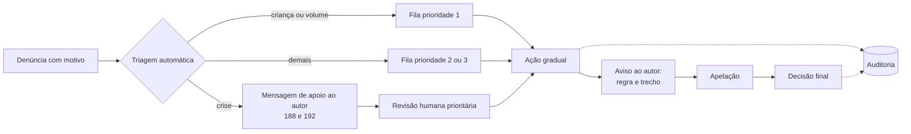

# Comunidade e moderação

Proposta de formato, regras e operação da comunidade do AppMaternidade, a partir da [pesquisa de comunidade e conteúdo](../08_Referencias/Pesquisa_Comunidade_e_Conteudo.md) e das fichas de concorrentes. Os números entre colchetes, como [1], remetem às fontes dessa pesquisa, consultadas em 22/10/2026. Os códigos F01 a F50 remetem à [pesquisa de privacidade, legal e lojas](../08_Referencias/Pesquisa_Privacidade_Legal_e_Lojas.md). Os códigos BC, KN e PN remetem às tabelas de fontes das fichas [BabyCenter](../08_Referencias/Concorrentes/BabyCenter.md), [Kinedu](../08_Referencias/Concorrentes/Kinedu.md) e [Peanut](../08_Referencias/Concorrentes/Peanut.md).

Tudo aqui é [HIP], salvo indicação: nada foi testado com usuários nem validado juridicamente.

## 1. Problema

- **Por que ter comunidade.** Quem cuida de um bebê quer saber se "isso é normal" e trocar experiência, muitas vezes de madrugada e com uma mão. Nas fontes consultadas, não foi identificada comunidade no app em nenhum dos quatro rastreadores de rotina analisados ([Concorrentes e diferenciais](../01_Produto/Concorrentes_e_Diferenciais.md)).
- **O valor tem condições.** O apoio entre pares pela internet oferece suporte emocional e informativo, mas a evidência de efetividade é inconclusiva [52]. Os riscos conhecidos são informação conflitante ou pouco confiável e o sentimento de inadequação diante de comparações [53].
- **Dois limites fixos da task:**
  - a comunidade não pode dar acesso à rotina privada de nenhuma criança;
  - quem modera não lê dados de família.
- **Exigências externas:** as lojas exigem filtro, denúncia, bloqueio e contato [1][2]. Depois do STF e dos decretos de 2026, há prazos curtos para alguns conteúdos [55; F18; F19; F20].

## 2. Formato proposto para o MVP

**Fórum assíncrono de tópicos e respostas, em espaços curados pela equipe:**

- **Espaços:** sono, alimentação, banho, tummy time, organização da rotina, divisão dos cuidados e dificuldades do dia a dia ([Modelo de dados, 3.4](../03_Arquitetura/Modelo_de_Dados_e_Permissoes.md)).
- **Tópicos:** cada um tem título, corpo e uma etiqueta opcional de faixa etária larga (0–3, 3–6, 6–12 meses).
- **Respostas:** um nível de resposta a resposta, sem árvore profunda.
- **Conteúdo fixado:** em cada espaço, um texto revisado pela equipe editorial ([Desenvolvimento e conteúdo](Desenvolvimento_e_Conteudo.md)).
- **Busca** dentro da comunidade.

**Fora do MVP:**

- imagens, vídeo e áudio;
- mensagem direta e chat;
- salas ao vivo;
- grupos por mês de nascimento;
- selo de profissional verificado;
- marcação "ajudou", ranking ou contagem pública de pessoas.

**Por que este formato:**

- **Encaixa no uso real:** a pergunta das 3h recebe resposta de manhã e continua útil para a próxima pessoa [HIP; pesquisa 1.2].
- **Moderação viável para equipe pequena:** a fila é assíncrona, com prazo, sem exigir alguém presente em tempo real [HIP].
- **Só texto reduz os riscos mais graves:** fotos de crianças, localização em metadados [57][59] e conteúdo íntimo, que tem prazo de remoção de 2 horas [F19 art. 7º].
- **Sem mensagem direta, menos assédio:** fecha o principal caminho de assédio e aliciamento, que nos recursos 1:1 exige bloqueio obrigatório [2] e que a Peanut mostra em relatos [Peanut](../08_Referencias/Concorrentes/Peanut.md).

## 3. Alternativas consideradas

| Formato | Ponto forte | Por que não no MVP |
| --- | --- | --- |
| Grupos por mês de nascimento (BabyCenter) | Coorte natural em grande escala [BC10] | Com pouca gente, vira sala vazia; expõe o mês de nascimento; cada grupo precisa de responsável |
| Chat em grupo em tempo real | Companhia imediata | Moderação quase em tempo real; histórico difícil de pesquisar; copia o que já existe em grupos de mensageria [HIP] |
| Salas de áudio ao vivo (Peanut "Pods") | Acolhimento por voz | Mediador presente, treinamento próprio [50] e dano que não se filtra antes. **Não descartado:** fica como etapa 3 (seção 4) |
| Comentários sob conteúdo (Kinedu) | Conversa contextual, de baixo custo | Bom complemento, mas sozinho não forma comunidade; o Kinedu não publica diretrizes [KN06]. Candidato à etapa 2 |
| Sem comunidade no app, com link para grupos externos | Custo zero de moderação | Abandona o pilar e perde a separação de dados que o app pode garantir |
| Software de fórum pronto (por exemplo, Discourse) | Funções maduras (níveis de confiança, sinalização) [40] | GPL v2 [38], integração por WebView ou API e outra base para separar da família; um módulo próprio mínimo parece mais coerente [HIP] |

A decisão está no [ADR-006](../06_ADRs/ADR-006_Comunidade_e_Moderacao.md).

## 4. Evolução por etapas

| Etapa | O que entra | Critério para avançar (limiares calibrados no piloto, não inventados agora) |
| --- | --- | --- |
| 0. Fundação (MAT-18, só se couber no prazo) | Perfil público separado, tópico e resposta, para provar a separação de dados. Sem moderação completa e sem painel ([Roadmap, seção 3](../07_Roadmap/Roadmap_e_Proxima_Fatia.md), item 8) | Teste que mostra que o módulo de comunidade não lê dados de família (Q-07; aceite A9) |
| 1. MVP de comunidade (MAT-19) | Formato da seção 2, com regras publicadas, denúncia, bloqueio e silenciar, fila, ações graduais, apelação, auditoria e painel web mínimo de moderação | Tempo até a primeira resposta humana; tópicos sem resposta; prazo de moderação cumprido por semanas seguidas; denúncias por mil publicações; reversões em apelação; pedidos por imagens, fases ou conversa ao vivo |
| 2. Expansão assíncrona | Imagens com salvaguardas; grupos por faixa larga, se houver volume; rodas assíncronas com anfitriã treinada; AMA assíncrono com profissional verificado | Moderação de imagem sem atraso; verificação de profissional funcionando; volume para grupos não ficarem vazios |
| 3. Rodas ao vivo (áudio) | Salas agendadas e pequenas, com mediador presente, sem gravação por padrão | Demanda medida; equipe treinada para áudio; protocolo de crise em tempo real; custo por minuto orçado [43][44] |
| 4. Mensagem direta | Só com demanda forte, com bloqueio desde o início | Risco de aliciamento e assédio mitigado; capacidade de moderação comprovada |

## 5. Identidade pública e fronteira com a família

- **Perfil público:** a conta tem um perfil pseudônimo, com apelido único, avatar genérico e bio curta. Ele se liga à conta só no servidor e não carrega família, bebê nem registro ([ADR-005](../06_ADRs/ADR-005_Isolamento_e_Fronteira_Comunidade.md)).
- **Faixa do bebê:** o aparelho sugere a faixa a partir da data de nascimento, e a pessoa escolhe se mostra. O servidor da comunidade recebe só a faixa escolhida, nunca a data ([Modelo de dados, 3.4](../03_Arquitetura/Modelo_de_Dados_e_Permissoes.md)).
- **Nada entra automaticamente:** a rotina não vai para a comunidade por conta própria. Se a pessoa quiser contar algo ("ele dormiu 40 minutos"), ela escreve, ou escolhe um resumo e vê a prévia exata antes de publicar (Q-07; [Offline, S5](../03_Arquitetura/Offline_Sincronizacao_e_Temporizadores.md)).
- **Permissões no banco:** o módulo de comunidade não tem permissão para ler os esquemas de família e cuidado ([Arquitetura proposta, 5.3](../03_Arquitetura/Arquitetura_Proposta.md)).
- **Moderador:** é um papel de plataforma e não dá leitura de dados de cuidado ([Modelo de dados, 5.2](../03_Arquitetura/Modelo_de_Dados_e_Permissoes.md)).
- **Fora da web aberta:** a comunidade fica dentro do app e não é indexada por buscadores. É o contrário do BabyCenter, onde os posts são indexáveis e ficam no ar depois que a conta é encerrada [BC06, BC11].

## 6. Regras da comunidade (resumo para a versão publicada)

Aceite obrigatório antes da primeira publicação [2]. Texto curto em pt-BR, com exemplos.

1. Aqui se conta experiência, não se dá diagnóstico. Todo post nasce como "relato pessoal".
2. Nada de indicar remédio, dose ou tratamento. Na dúvida, procure um profissional de saúde.
3. Não exponha crianças nem outras pessoas: nada de nome completo, escola, endereço ou rotina de terceiros.
4. Sem venda, troca ou propaganda, inclusive de remédios e de fórmula infantil (regra semelhante à do BabyCenter Brasil [BC11]).
5. Respeito: sem ataque, assédio, discriminação ou pressão ("você deveria…").
6. Sem print ou repostagem de conteúdo de outra pessoa sem permissão [PN06].
7. Denúncia é para proteger. Denúncia usada como retaliação também vale como violação [PN06; F13 art. 32].

Cada espaço tem um aviso fixo de que a comunidade não é atendimento de saúde, com o caminho para os canais de crise [1].

## 7. Denúncia, bloqueio e silenciar

| Ação | Quem pode | Efeito para quem age | Efeito para o outro | Quem recebe |
| --- | --- | --- | --- | --- |
| Denunciar tópico, resposta ou perfil | Qualquer conta | O item continua visível (ou fica oculto para quem denunciou, se ela quiser), com confirmação de recebimento | Nenhum aviso de quem denunciou | Fila de moderação; o motivo "risco de autolesão" segue a rota de crise (seção 9) |
| Bloquear | Qualquer conta | Efeito imediato e mútuo: deixa de ver o conteúdo da outra pessoa e não pode responder a ela | Também deixa de ver o conteúdo de quem bloqueou e não pode responder nem mencionar; não é avisada | Ninguém; fica registrado |
| Silenciar pessoa | Qualquer conta | Oculta o conteúdo, sem impedir interação | Nenhum | Ninguém |
| Silenciar palavras | Qualquer conta | Oculta posts com os termos escolhidos (por exemplo, sobre perda gestacional) [PN14] | Nenhum | Ninguém |
| "Estou preocupada com esta pessoa" | Qualquer conta | Envia um alerta de cuidado, não de punição [PN09] | A pessoa recebe recursos de apoio, sem saber quem enviou | Fila de moderação, como cuidado |

Motivos de denúncia: ataque ou assédio; informação de saúde perigosa; conteúdo sexual; exposição de criança; dados pessoais; spam ou venda; risco de autolesão; outro [pesquisa 1.4]. Logo depois de denunciar, o app oferece bloquear, silenciar ou sair do tópico [PN09].

## 8. Fila, ações, apelação e auditoria

**Prioridades da fila:**

1. Risco de vida e conteúdo envolvendo criança.
2. Assédio e dados pessoais.
3. Desinformação e spam.

O moderador vê o conteúdo, o perfil público e o histórico de moderação daquele perfil, nunca dados de família.

**Ações, em ordem gradual:**

1. Ocultar até a análise.
2. Remover.
3. Advertir.
4. Somente leitura temporária.
5. Suspender.
6. Banir.

Cada ação informa ao autor a regra aplicada e o trecho afetado [51].

**Apelação:** um pedido por ação, analisado por outra pessoa sempre que possível, com prazo publicado [51; 55].

**Auditoria:** registro imutável de quem agiu, quando, com qual regra, qual ação e sobre qual versão do conteúdo. O acesso é restrito e a retenção está em [Privacidade e segurança, 8](../05_Privacidade_Operacao/Privacidade_e_Seguranca.md). A auditoria alimenta o relatório anual de transparência [55; F20].

**Filtros automáticos:**

- lista de termos em pt-BR, inclusive de crise;
- limite de publicações por hora;
- links bloqueados e primeiras publicações revisadas antes de aparecer, para contas novas [40].

Moderação por API externa só depois de revisão de privacidade e contrato, e nunca como decisão final sozinha [pesquisa 1.8].

Fluxo:

## 9. Crise e conteúdos graves

**Canais oficiais, confirmados em 22/10/2026:**

| Canal | Quando usar | Fonte |
| --- | --- | --- |
| CVV 188 | Sofrimento emocional e ideação suicida; atende por ligação, chat e e-mail | [4][5] |
| SAMU 192 | Urgência de saúde | [6] |
| Ligue 180 | Violência contra a mulher | [9] |
| Disque 100 | Violação de direitos de crianças e adolescentes | [8] |

**Comportamento proposto:**

1. **Gatilhos:** denúncia com motivo "risco de autolesão", termos de crise ou alerta "estou preocupada".
2. **Para quem escreveu:** mensagem de acolhimento, sem julgamento e sem diagnóstico, com os canais acima. Ela nunca diz que o conteúdo "violou regras". A depressão pós-parto "não é uma falha de caráter ou uma fraqueza" e também acontece com homens [7].
3. **Visibilidade:**
   - relato de sofrimento sem risco imediato continua visível, com os recursos fixados abaixo;
   - conteúdo que induz ou instrui autolesão é removido na hora [55].
4. **Fora do horário coberto:** o conteúdo com gatilho fica oculto do público, o autor continua vendo o próprio post e recebe os recursos, e a revisão acontece na abertura do turno.
5. **Roteiro escrito com profissional de saúde mental:** os moderadores não são clínicos.

**Conteúdo sexual envolvendo criança:**

- remoção imediata;
- preservação da evidência conforme orientação jurídica;
- comunicação às autoridades [55; F13 art. 27; F15 arts. 36 a 39].

Esse material nunca vai para API de moderação de terceiros [32]. O fluxo é próprio, separado da moderação comum, e é ensaiado antes do piloto.

**Prazos legais curtos** (conferir com o jurídico):

- conteúdo íntimo não autorizado: 2 horas [F19 art. 7º];
- crimes graves contra crianças e induzimento à autolesão: remoção imediata [55];
- demais prazos, de 6 h e 24 h, conforme o tipo [F17; F19].

Só texto no MVP reduz, mas não elimina, a exposição a esses prazos.

## 10. Operação no MVP

| Item | Proposta | Situação |
| --- | --- | --- |
| Quem modera | Equipe do produto mais uma ou duas pessoas treinadas em meio período; sem voluntários no começo; sem acesso a dados de família | Custo de pessoas: decisão D5 |
| Prazos | Crise e criança: triagem em até 1 hora dentro do horário coberto. Demais denúncias: até 24 horas | Hipóteses a calibrar no piloto |
| Horário coberto | Publicado (por exemplo, todos os dias, das 8h às 22h); fora dele valem as regras automáticas da seção 9 | A definir |
| Ferramentas | Painel web com fila, contexto, ações, histórico do autor, modelos de mensagem, auditoria e exportação de evidência | Parte da MAT-19 ([ADR-001](../06_ADRs/ADR-001_Plataformas_e_Web.md): web como painel interno) |
| Métricas | Tempo até a primeira ação; volume por motivo; reversões em apelação; tópicos sem resposta; tempo até a primeira resposta humana | Painel interno |
| Transparência | Relatório periódico simples; relatório anual exigido pela tese do STF [55; F20] | Formato a definir |

Para comparação, o Mumsnet declarou moderação profissional 7 dias por semana, com tempo médio de resposta de 1h26 [48]. O MVP não chega a esse nível. A compensação vem de quatro medidas: horário publicado, ocultação automática fora do turno, revisão prévia das contas novas e ausência de tempo real.

## 11. Exclusão e retenção

- Quando a conta é excluída, posts e respostas do autor são apagados. Os tópicos de outras pessoas ficam com "[removido]" no lugar da resposta [F24].
- Retém-se só o necessário por obrigação legal (registros de acesso, relatórios de abuso, ordem judicial), isolado e com prazo ([Privacidade e segurança, 7 e 8](../05_Privacidade_Operacao/Privacidade_e_Seguranca.md)).
- Um conteúdo removido por moderação sai da busca e das listas na hora. A versão fica só na auditoria.

## 12. Lojas

- **Apple 1.2:** filtro de material ofensivo, denúncia com resposta em tempo hábil, bloqueio e contato publicado. O desenvolvedor responde por remover conteúdo que viole as regras [1].
- **Google Play, UGC:** aceite dos termos antes de publicar, definição do proibido, moderação contínua, denúncia e bloqueio dentro do app [2].
- **Google Play, padrões de segurança infantil:** valem para as categorias "Social" e "Dating" [3]. A categoria proposta é "Parenting" [HIP], mas adotar os padrões mesmo assim é prudente.

## 13. Cenários de validação

| Cenário | O que precisa acontecer | Onde é testado |
| --- | --- | --- |
| Q-07 Publicar e ler | Nenhum acesso à família; resumo de rotina só com prévia e confirmação | [Qualidade e validação](../05_Privacidade_Operacao/Qualidade_e_Validacao.md); MAT-18 e MAT-19 |
| Q-11 Denunciar, bloquear, excluir | Visibilidade conforme as seções 7, 8 e 11; ação registrada | Idem |
| Crise | Mensagem de apoio, ocultação fora do turno e revisão no turno | Ensaio com dados fictícios antes do piloto |

## 14. Questões abertas

1. Idade mínima: 18+ no MVP (decisão D4)? Mães e pais adolescentes ficariam fora.
2. Horário de moderação e quem cobre: decisão D5.
3. Haverá espaço próprio para perda gestacional e luto, com regras e moderação específicas?
4. Que categoria declarar na Google Play?
5. Quem escreve o roteiro de crise com profissional de saúde mental?

## Limites desta análise

- Proposta sem teste com usuários, sem validação jurídica e sem roteiro clínico.
- Prazos e métricas são hipóteses para calibrar no piloto.
- Documento escrito pelo coordenador, porque o redator delegado parou por falta de resposta do provedor.

## Relação com outros documentos

[ADR-006](../06_ADRs/ADR-006_Comunidade_e_Moderacao.md) · [ADR-005](../06_ADRs/ADR-005_Isolamento_e_Fronteira_Comunidade.md) · [Fluxos e telas, 3.5 e 4.9](../02_Experiencia/Fluxos_e_Telas.md) · [Modelo de dados e permissões](../03_Arquitetura/Modelo_de_Dados_e_Permissoes.md) · [Privacidade e segurança](../05_Privacidade_Operacao/Privacidade_e_Seguranca.md) · [Custos e operação](../05_Privacidade_Operacao/Custos_e_Operacao.md) · [Desenvolvimento e conteúdo](Desenvolvimento_e_Conteudo.md) · [Pesquisa de comunidade e conteúdo](../08_Referencias/Pesquisa_Comunidade_e_Conteudo.md)
