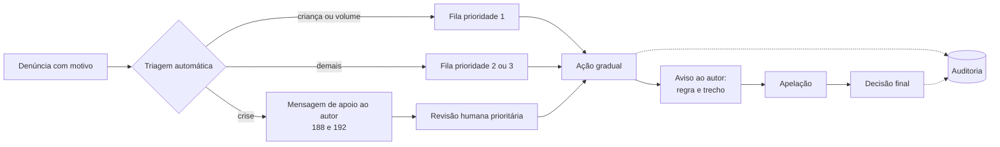

# Community and moderation

> Note from 03/11/2026: the direction changed to a full website first and an Android and iOS port later ([ADR-009](../06_ADRs/ADR-009_Site_Completo_Primeiro.md)). Where this text refers to a native app, read it as the port; the website covers the same functions.

Proposed format, rules and operation of the AppMaternidade community, based on the [community and content research](../08_Referencias/Pesquisa_Comunidade_e_Conteudo.md) and the competitor profiles. Numbers in square brackets, such as [1], refer to the sources of that research, consulted on 22/10/2026. The codes F01 to F50 refer to the [privacy, legal and app store research](../08_Referencias/Pesquisa_Privacidade_Legal_e_Lojas.md). The codes BC, KN and PN refer to the source tables in the [BabyCenter](../08_Referencias/Concorrentes/BabyCenter.md), [Kinedu](../08_Referencias/Concorrentes/Kinedu.md) and [Peanut](../08_Referencias/Concorrentes/Peanut.md) profiles.

Everything here is [HIP] unless otherwise stated: nothing has been tested with users or legally validated.

## 1. Problem

- **Why have a community.** People caring for a baby want to know whether "isso é normal" and to exchange experiences, often in the middle of the night and with one hand. In the sources consulted, no in-app community was identified in any of the four routine trackers analyzed ([Competitors and differentiators](../01_Produto/Concorrentes_e_Diferenciais.md)).
- **The value comes with conditions.** Online peer support offers emotional and informational support, but the evidence of effectiveness is inconclusive [52]. The known risks are conflicting or unreliable information and feelings of inadequacy in the face of comparisons [53].
- **Two fixed limits of the task:**
  - the community cannot provide access to any child's private routine;
  - moderators do not read family data.
- **External requirements:** the app stores require filtering, reporting, blocking and contact information [1][2]. Following the STF decision and the decrees of 2026, there are short deadlines for some content [55; F18; F19; F20].

## 2. Proposed format for the MVP

**Asynchronous forum of topics and replies, in spaces curated by the team:**

- **Spaces:** sleep, feeding, bathing, tummy time, routine organization, division of care and day-to-day difficulties ([Data model, 3.4](../03_Arquitetura/Modelo_de_Dados_e_Permissoes.md)).
- **Topics:** each has a title, a body and an optional broad age-range tag (0–3, 3–6, 6–12 months).
- **Replies:** one level of reply-to-reply, with no deep tree.
- **Pinned content:** in each space, a text reviewed by the editorial team ([Development and content](Desenvolvimento_e_Conteudo.md)).
- **Search** within the community.

**Outside the MVP:**

- images, video and audio;
- direct messages and chat;
- live rooms;
- birth-month groups;
- verified professional badge;
- "ajudou" marking, rankings or public people counts.

**Why this format:**

- **Fits real usage:** the 3h question gets an answer in the morning and remains useful for the next person [HIP; research 1.2].
- **Moderation feasible for a small team:** the queue is asynchronous, with deadlines, and does not require someone present in real time [HIP].
- **Text only reduces the most serious risks:** photos of children, location in metadata [57][59] and intimate content, which has a removal deadline of 2 hours [F19 art. 7º].
- **No direct messages, less harassment:** closes the main path for harassment and grooming, which in 1:1 features requires mandatory blocking [2] and which Peanut illustrates in user reports [Peanut](../08_Referencias/Concorrentes/Peanut.md).

## 3. Alternatives considered

| Format | Strength | Why not in the MVP |
| --- | --- | --- |
| Birth-month groups (BabyCenter) | Natural cohort at large scale [BC10] | With few people, it becomes an empty room; it exposes the birth month; each group needs someone in charge |
| Real-time group chat | Immediate companionship | Near-real-time moderation; history hard to search; copies what already exists in messaging groups [HIP] |
| Live audio rooms (Peanut "Pods") | Voice-based emotional support | A mediator present, dedicated training [50] and harm that cannot be filtered in advance. **Not ruled out:** remains as stage 3 (section 4) |
| Comments under content (Kinedu) | Contextual, low-cost conversation | A good complement, but on its own it does not form a community; Kinedu does not publish guidelines [KN06]. Candidate for stage 2 |
| No in-app community, with a link to external groups | Zero moderation cost | Abandons the pillar and loses the data separation the app can guarantee |
| Off-the-shelf forum software (for example, Discourse) | Mature features (trust levels, flagging) [40] | GPL v2 [38], integration via WebView or API, and another database to separate from family data; a minimal in-house module seems more coherent [HIP] |

The decision is in [ADR-006](../06_ADRs/ADR-006_Comunidade_e_Moderacao.md).

## 4. Phased evolution

| Stage | What is included | Criteria for advancing (thresholds calibrated in the pilot, not invented now) |
| --- | --- | --- |
| 0. Foundation (MAT-18, only if it fits the deadline) | Separate public profile, topic and reply, to prove data separation. No full moderation and no dashboard ([Roadmap, section 3](../07_Roadmap/Roadmap_e_Proxima_Fatia.md), item 8) | A test showing that the community module does not read family data (Q-07; acceptance A9) |
| 1. Community MVP (MAT-19) | The format from section 2, with published rules, reporting, blocking and muting, a queue, graduated actions, appeals, auditing and a minimal web moderation dashboard | Time to first human reply; unanswered topics; moderation deadline met for consecutive weeks; reports per thousand posts; reversals on appeal; requests for images, phases or live conversation |
| 2. Asynchronous expansion | Images with safeguards; broad-range groups, if there is enough volume; asynchronous circles with a trained host; asynchronous AMA with a verified professional | Image moderation without delays; professional verification working; enough volume that groups are not empty |
| 3. Live circles (audio) | Small, scheduled rooms with a mediator present, no recording by default | Measured demand; team trained for audio; real-time crisis protocol; per-minute cost budgeted [43][44] |
| 4. Direct messages | Only with strong demand, with blocking from the start | Grooming and harassment risk mitigated; moderation capacity proven |

## 5. Public identity and the boundary with the family

- **Public profile:** the account has a pseudonymous profile, with a unique nickname, a generic avatar and a short bio. It is linked to the account only on the server and carries no family, baby or log data ([ADR-005](../06_ADRs/ADR-005_Isolamento_e_Fronteira_Comunidade.md)).
- **Baby's age range:** the device suggests the range from the date of birth, and the person chooses whether to show it. The community server receives only the chosen range, never the date ([Data model, 3.4](../03_Arquitetura/Modelo_de_Dados_e_Permissoes.md)).
- **Nothing gets in automatically:** the routine does not go to the community on its own. If the person wants to share something ("ele dormiu 40 minutos"), they write it, or they choose a summary and see the exact preview before publishing (Q-07; [Offline, S5](../03_Arquitetura/Offline_Sincronizacao_e_Temporizadores.md)).
- **Database permissions:** the community module has no permission to read the family and care schemas ([Proposed architecture, 5.3](../03_Arquitetura/Arquitetura_Proposta.md)).
- **Moderator:** a platform role that does not grant read access to care data ([Data model, 5.2](../03_Arquitetura/Modelo_de_Dados_e_Permissoes.md)).
- **Off the open web:** the community stays inside the app and is not indexed by search engines. This is the opposite of BabyCenter, where posts are indexable and remain online after the account is closed [BC06, BC11].

## 6. Community rules (summary for the published version)

Mandatory acceptance before the first post [2]. Short text in pt-BR, with examples.

1. This is a place to share experience, not to give diagnoses. Every post starts out as "relato pessoal".
2. No recommending medicines, doses or treatments. When in doubt, see a health professional.
3. Do not expose children or other people: no full names, schools, addresses or other people's routines.
4. No selling, swapping or advertising, including medicines and infant formula (a rule similar to BabyCenter Brasil's [BC11]).
5. Respect: no attacks, harassment, discrimination or pressure ("você deveria…").
6. No screenshots or reposting of another person's content without permission [PN06].
7. Reporting is for protection. Using reports as retaliation also counts as a violation [PN06; F13 art. 32].

Each space has a pinned notice that the community is not a health service, with the path to crisis channels [1].

## 7. Reporting, blocking and muting

| Action | Who can | Effect for the person acting | Effect for the other person | Who receives it |
| --- | --- | --- | --- | --- |
| Report a topic, reply or profile | Any account | The item stays visible (or is hidden for the reporter, if they wish), with confirmation of receipt | No notice of who reported | Moderation queue; the "risco de autolesão" reason follows the crisis route (section 9) |
| Block | Any account | Immediate and mutual effect: stops seeing the other person's content and cannot reply to them | Also stops seeing the blocker's content and cannot reply to or mention them; is not notified | No one; it is logged |
| Mute a person | Any account | Hides their content, without preventing interaction | None | No one |
| Mute words | Any account | Hides posts containing the chosen terms (for example, about pregnancy loss) [PN14] | None | No one |
| "Estou preocupada com esta pessoa" | Any account | Sends a care alert, not a punishment [PN09] | The person receives support resources, without knowing who sent it | Moderation queue, as a care matter |

Report reasons: attack or harassment; dangerous health information; sexual content; exposure of a child; personal data; spam or selling; risk of self-harm; other [research 1.4]. Right after reporting, the app offers to block, mute or leave the topic [PN09].

## 8. Queue, actions, appeals and auditing

**Queue priorities:**

1. Risk to life and content involving children.
2. Harassment and personal data.
3. Misinformation and spam.

The moderator sees the content, the public profile and that profile's moderation history, never family data.

**Actions, in graduated order:**

1. Hide pending review.
2. Remove.
3. Warn.
4. Temporary read-only.
5. Suspend.
6. Ban.

Each action informs the author of the rule applied and the affected excerpt [51].

**Appeals:** one request per action, reviewed by a different person whenever possible, with a published deadline [51; 55].

**Auditing:** an immutable record of who acted, when, under which rule, with which action and on which version of the content. Access is restricted and retention is covered in [Privacy and security, 8](../05_Privacidade_Operacao/Privacidade_e_Seguranca.md). The audit log feeds the annual transparency report [55; F20].

**Automatic filters:**

- a list of terms in pt-BR, including crisis terms;
- a limit on posts per hour;
- blocked links and first posts reviewed before they appear, for new accounts [40].

Moderation via an external API only after a privacy and contract review, and never as the sole final decision [research 1.8].

Flow:

## 9. Crisis and serious content

**Official channels, confirmed on 22/10/2026:**

| Channel | When to use | Source |
| --- | --- | --- |
| CVV 188 | Emotional distress and suicidal ideation; available by phone call, chat and email | [4][5] |
| SAMU 192 | Health emergency | [6] |
| Ligue 180 | Violence against women | [9] |
| Disque 100 | Violations of the rights of children and adolescents | [8] |

**Proposed behavior:**

1. **Triggers:** a report with the reason "risco de autolesão", crisis terms or a "estou preocupada" alert.
2. **For the person who wrote it:** a supportive message, without judgment and without diagnosis, with the channels above. It never says that the content "violou regras". Postpartum depression "não é uma falha de caráter ou uma fraqueza" and also happens to men [7].
3. **Visibility:**
   - an account of distress without immediate risk stays visible, with the resources pinned below it;
   - content that induces or instructs self-harm is removed immediately [55].
4. **Outside covered hours:** content with a trigger is hidden from the public, the author can still see their own post and receives the resources, and the review happens when the shift opens.
5. **Script written with a mental health professional:** the moderators are not clinicians.

**Sexual content involving children:**

- immediate removal;
- preservation of evidence according to legal guidance;
- reporting to the authorities [55; F13 art. 27; F15 arts. 36 to 39].

This material never goes to a third-party moderation API [32]. The flow is in-house, separate from regular moderation, and is rehearsed before the pilot.

**Short legal deadlines** (to be checked with legal):

- non-consensual intimate content: 2 hours [F19 art. 7º];
- serious crimes against children and inducement to self-harm: immediate removal [55];
- other deadlines, of 6 h and 24 h, depending on the type [F17; F19].

Text only in the MVP reduces, but does not eliminate, exposure to these deadlines.

## 10. Operations in the MVP

| Item | Proposal | Status |
| --- | --- | --- |
| Who moderates | The product team plus one or two trained part-time people; no volunteers at the start; no access to family data | Staffing cost: decision D5 |
| Deadlines | Crisis and children: triage within 1 hour during covered hours. Other reports: within 24 hours | Hypotheses to calibrate in the pilot |
| Covered hours | Published (for example, every day, from 8h to 22h); outside them, the automatic rules in section 9 apply | To be defined |
| Tools | Web dashboard with queue, context, actions, author history, message templates, audit log and evidence export | Part of MAT-19 ([ADR-001](../06_ADRs/ADR-001_Plataformas_e_Web.md): web as an internal dashboard) |
| Metrics | Time to first action; volume by reason; reversals on appeal; unanswered topics; time to first human reply | Internal dashboard |
| Transparency | Simple periodic report; annual report required by the STF's legal thesis [55; F20] | Format to be defined |

For comparison, Mumsnet reported professional moderation 7 days a week, with an average response time of 1h26 [48]. The MVP does not reach that level. This is offset by four measures: published hours, automatic hiding outside the shift, prior review of new accounts and the absence of real-time features.

## 11. Deletion and retention

- When the account is deleted, the author's posts and replies are erased. Other people's topics show "[removido]" in place of the reply [F24].
- Only what is required by legal obligation is retained (access logs, abuse reports, court orders), isolated and time-limited ([Privacy and security, 7 and 8](../05_Privacidade_Operacao/Privacidade_e_Seguranca.md)).
- Content removed by moderation leaves search and listings immediately. The version remains only in the audit log.

## 12. App stores

- **Apple 1.2:** a filter for objectionable material, reporting with a timely response, blocking and published contact information. The developer is responsible for removing content that violates the rules [1].
- **Google Play, UGC:** acceptance of the terms before posting, a definition of what is prohibited, ongoing moderation, and in-app reporting and blocking [2].
- **Google Play, child safety standards:** these apply to the "Social" and "Dating" categories [3]. The proposed category is "Parenting" [HIP], but adopting the standards anyway is prudent.

## 13. Validation scenarios

| Scenario | What must happen | Where it is tested |
| --- | --- | --- |
| Q-07 Post and read | No access to the family; routine summary only with preview and confirmation | [Quality and validation](../05_Privacidade_Operacao/Qualidade_e_Validacao.md); MAT-18 and MAT-19 |
| Q-11 Report, block, delete | Visibility as described in sections 7, 8 and 11; action logged | Same |
| Crisis | Support message, hiding outside the shift and review during the shift | Rehearsal with fictitious data before the pilot |

## 14. Open questions

1. Minimum age: 18+ in the MVP (decision D4)? Teenage mothers and fathers would be left out.
2. Moderation hours and who covers them: decision D5.
3. Will there be a dedicated space for pregnancy loss and grief, with specific rules and moderation?
4. Which category should be declared on Google Play?
5. Who writes the crisis script with a mental health professional?

## Limits of this analysis

- A proposal without user testing, without legal validation and without a clinical script.
- Deadlines and metrics are hypotheses to calibrate in the pilot.
- Document written by the coordinator, because the delegated writer stopped due to a lack of response from the provider.

## Relationship to other documents

[ADR-006](../06_ADRs/ADR-006_Comunidade_e_Moderacao.md) · [ADR-005](../06_ADRs/ADR-005_Isolamento_e_Fronteira_Comunidade.md) · [Flows and screens, 3.5 and 4.9](../02_Experiencia/Fluxos_e_Telas.md) · [Data model and permissions](../03_Arquitetura/Modelo_de_Dados_e_Permissoes.md) · [Privacy and security](../05_Privacidade_Operacao/Privacidade_e_Seguranca.md) · [Costs and operations](../05_Privacidade_Operacao/Custos_e_Operacao.md) · [Development and content](Desenvolvimento_e_Conteudo.md) · [Community and content research](../08_Referencias/Pesquisa_Comunidade_e_Conteudo.md)
