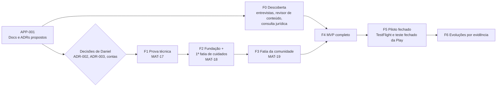

# Roadmap and next slice

## Current direction (03/11/2026)

Daniel decided on 03/11/2026 to start with the complete website, with RF-01 to RF-14, and port it to Android and iOS later ([ADR-009](../06_ADRs/ADR-009_Site_Completo_Primeiro.md)). The phases, in order:

1. design docs (MAT-32);
2. visual reference (MAT-33), visual direction and tokens (MAT-34);
3. foundation (MAT-35) and local backend (MAT-43);
4. website slices (MAT-36 to MAT-41);
5. final gate: combined quality review and acceptance of the entire website (MAT-42);
6. pilot with invited real families: depends on D5 (MAT-24), D7 (MAT-26) and D9 (MAT-29);
7. Android and iOS port. MAT-17, MAT-18 and MAT-19 remain frozen until then. Their product scope is absorbed into the website slices; the native portion remains.

Former F0: discovery, content reviewer and legal consultation run in parallel with phases 1 to 5 and are prerequisites for phase 6.

Every task that changes the website passes through gates G1 to G12 in [Visual direction](../02_Experiencia/Direcao_Visual.md). The pages for each slice are in the [site map](../02_Experiencia/Site_Mapa_e_Paginas.md), and the open decisions are in [Decisions for Daniel](Decisoes_para_Daniel.md).

## Previous direction (APP-001)

> Replaced by ADR-009 on 03/11/2026. The text below remains as a record, with no changes other than heading levels.
>
> In the current direction, the acceptance criteria are in tasks MAT-35 to MAT-43 and gates G1 to G12.

Proposal by Hermes. Nothing here has been implemented: this document plans the next steps. The stack for each step depends on Daniel's decision on ADRs 002 and 003; future tasks are in itsaplan as Backlog, with no agent assigned, and only start upon explicit request.

### 1. Where we are

| Step | Status |
| --- | --- |
| APP-001 — research, design docs, ADRs, organization | Being delivered (this step) |
| Implementation | Not started. No product code exists. |

### 2. Phases

| Phase | Objective | Includes | Exits when |
| --- | --- | --- | --- |
| F0 Discovery (parallel) | Test product hypotheses before investing in screens | Interviews with 8 to 12 caregivers (including grandparents and nannies), language testing ("família"), hired or partner content reviewer, initial legal consultation (LGPD and Digital ECA) | Personas and quick buttons revised; reviewer selected; initial legal opinion recorded |
| F1 Technical proof (MAT-17) | Choose the stack based on evidence | Proofs P1 to P9 from [Quality and validation](../05_Privacidade_Operacao/Qualidade_e_Validacao.md), in disposable code | ADR-002, 003 and 004 accepted or revised by Daniel based on the results |
| F2 Foundation and slice 1 (MAT-18) | Real product foundation and the core of shared care | Section 3 of this document | Criteria A1 to A11 approved |
| F3 Community slice (MAT-19) | Minimal community with moderation | Spaces, topics, replies, reporting, blocking, minimal dashboard | Q-07 and Q-11 approved; community rules published |
| F4 Complete MVP | All four pillars usable | Requirements RF-01 to RF-14 from [Vision and scope](../01_Produto/Visao_e_Escopo.md); public website; reviewed content for ages 0 to 12 months; export and deletion; accessibility | Store checklist and scenarios Q-01 to Q-12 approved |
| F5 Closed pilot | Real use with a few families | TestFlight and Play closed testing; active moderation; metrics from [Vision and scope](../01_Produto/Visao_e_Escopo.md) | Launch decision based on data |
| F6 Enhancements | Expand based on what the pilot shows | Candidates: ages 0 to 24 months, widgets and Live Activities, attachments, groups by stage, web app for caregivers | Each with its own ADR or decision |

### 3. Next executable slice (proposed, not implemented)

#### Objetivo

Prove the product's core on Android and iOS: shared care with offline recording, synchronization, authorship and revocation, and show that the community does not access family data.

#### Escopo

1. Email account with a single-use code (no social login, which avoids the requirement of App Store guideline 4.8 at this phase).
2. Create a family and register a baby (name or nickname and date of birth).
3. Invitation with a single-use code, Cuidador role and validity of 7 days; acceptance on another device.
4. Tummy time session: start, end, record retroactively; working offline.
5. Local database, operation queue, idempotent sending, cursor-based receiving, visible states ("aguardando envio", "sincronizado", "não enviado").
6. Daily history with authorship, in the family's time zone.
7. Membership revocation with local cleanup upon reconnection.
8. If time allows: one community space with a topic and reply posted through a public profile, without full moderation, just to prove data separation (Q-07).

#### Outside the slice

Other record types, handoff notes, push, timer outside the app, editorial content, moderation dashboard, export and deletion, final visual identity.

#### Pré-requisitos

| Item | Android | iOS |
| --- | --- | --- |
| Tools | Android Studio, SDK and emulator on Windows | Build path defined in ADR-002: cloud build service or Mac |
| Account | Google Play Console (one-time fee; personal accounts require closed testing with 12 testers for 14 days before production) | Apple Developer Program (annual fee), required for TestFlight and push |
| Device | One physical Android device | One physical iPhone |
| Backend | Development environment for the stack chosen in ADR-003, with fictional data | The same |

Account and service costs in [Dated prices](../08_Referencias/Tecnologias/Precos_Datados.md). Opening accounts and purchasing services are Daniel's decisions.

#### Acceptance criteria

| ID | Criterion | Scenario |
| --- | --- | --- |
| A1 | The guardian creates an account, family and baby on a physical Android device and a physical iPhone, with a test build installed | — |
| A2 | The guardian generates an invitation; the caregiver accepts on another device, on a different platform, and appears as Cuidador | — |
| A3 | In airplane mode, the caregiver starts tummy time, closes the app through the system and reopens it: the session continues and the duration matches a reference stopwatch (difference of up to 1 second) | Q-01, Q-08 |
| A4 | Still offline, the caregiver ends the session; when the network returns, the record synchronizes and appears in the other device's history with "por <cuidador>" | Q-01 |
| A5 | Automated integration test: 200 send cycles with a lost response or timeout do not create a duplicate record | Q-02 |
| A6 | With the caregiver's device offline, the guardian revokes the membership; upon reconnection, pending operations are rejected, the family's local data disappears and the notice appears | Q-05 |
| A7 | Automated test: IDs from another family, across all routes and the slice's synchronization channel, receive the same response as a nonexistent ID | Q-06 |
| A8 | Unit tests for midnight, time zone changes and daylight saving time pass; history groups records by the family's time zone | Q-09 |
| A9 | If item 8 is included: topic and reply published through a public profile; a schema test confirms that nothing in the community references a family, baby or record | Q-07 |
| A10 | Logs without sensitive data (automated scan); screenshots and traces only for failures; independent review with no blocking findings | — |
| A11 | The guardian starts a tummy time session, which synchronizes; the caregiver ends it on the other device, which may be offline. After synchronization, both devices show a single session, with "iniciada por <responsável>" and "encerrada por <cuidador>". A second simultaneous ending follows the policy in [Offline, section 7.2](../03_Arquitetura/Offline_Sincronizacao_e_Temporizadores.md), without deleting the first | Q-03 |

#### Evidence required for slice delivery

Test commands and results, tool versions, device models and versions, screenshots of the manual criteria and the review report. A plan is not evidence: without these items, the slice is not ready.

### 4. Tasks in itsaplan

| Key | Task | Status |
| --- | --- | --- |
| MAT-17 | Validate the stack with a small proof (F1) | Backlog, no agent, awaiting Daniel's request |
| MAT-18 | Foundation and first care slice (F2, section 3) | Backlog, blocked by MAT-17 |
| MAT-19 | Initial community slice (F3) | Backlog, blocked by MAT-18 |

### Open questions

1. Technical proof and slice separate or together: the proposal is to separate them, to avoid carrying disposable code into the product.
2. Item 8 of the slice (minimal community) included or excluded.
3. Who participates in discovery and how they are recruited.

### Limits of this analysis

Planning without execution or a time estimate: there is no productivity history on which to base numbers. Store requirements were read on 22/10/2026.

## Open questions

1. D5 (MAT-24) and D7 (MAT-26): people for content and moderation, and access test records; these are conditions for phase 6.
2. Native features of the port (ADR-009, section 4): determine when phase 7 can begin.
