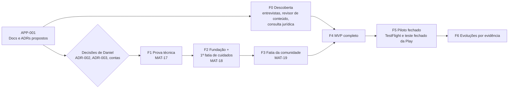

# Roadmap e próxima fatia

## Rumo atual (03/11/2026)

Daniel decidiu em 03/11/2026 começar pelo site completo, com RF-01 a RF-14, e fazer o port para Android e iOS depois ([ADR-009](../06_ADRs/ADR-009_Site_Completo_Primeiro.md)). As fases, em ordem:

1. design docs (MAT-32);
2. referência visual (MAT-33), direção visual e tokens (MAT-34);
3. fundação (MAT-35) e backend local (MAT-43);
4. fatias do site (MAT-36 a MAT-41);
5. portão final: junção de qualidade e aceite do site inteiro (MAT-42);
6. piloto com famílias reais convidadas: depende de D5 (MAT-24), D7 (MAT-26) e D9 (MAT-29);
7. port Android e iOS. MAT-17, MAT-18 e MAT-19 ficam congeladas até lá. O que elas tinham de produto é absorvido pelas fatias do site; sobra a parte nativa.

Antiga F0: descoberta, revisor de conteúdo e consulta jurídica correm em paralelo às fases 1 a 5 e são pré-requisito da fase 6.

Toda tarefa que mexe no site passa pelos portões G1 a G12 de [Direção visual](../02_Experiencia/Direcao_Visual.md). As páginas de cada fatia estão no [mapa do site](../02_Experiencia/Site_Mapa_e_Paginas.md), e as decisões abertas, em [Decisões para Daniel](Decisoes_para_Daniel.md).

## Rumo anterior (APP-001)

> Substituído pelo ADR-009 em 03/11/2026. O texto abaixo fica como registro, sem mudanças além do nível dos títulos.
>
> No rumo atual, os critérios de aceite estão nas tarefas MAT-35 a MAT-43 e nos portões G1 a G12.

Proposta do Hermes. Nada do que está aqui foi implementado: este documento planeja as etapas seguintes. A stack de cada etapa depende da decisão de Daniel sobre os ADRs 002 e 003; as tarefas futuras estão no itsaplan como Backlog, sem agente atribuído, e só começam com pedido explícito.

### 1. Onde estamos

| Etapa | Situação |
| --- | --- |
| APP-001 — pesquisa, design docs, ADRs, organização | Em entrega (esta etapa) |
| Implementação | Não iniciada. Nenhum código do produto existe. |

### 2. Fases

| Fase | Objetivo | Entra | Sai quando |
| --- | --- | --- | --- |
| F0 Descoberta (paralela) | Testar hipóteses de produto antes de investir em telas | Entrevistas com 8 a 12 cuidadores (incluindo avós e babás), teste de linguagem ("família"), revisor de conteúdo contratado ou parceiro, consulta jurídica inicial (LGPD e ECA Digital) | Personas e botões rápidos revistos; revisor definido; parecer inicial registrado |
| F1 Prova técnica (MAT-17) | Escolher a stack com evidência | Provas P1 a P9 de [Qualidade e validação](../05_Privacidade_Operacao/Qualidade_e_Validacao.md), em código descartável | ADR-002, 003 e 004 aceitos ou revistos por Daniel com base no resultado |
| F2 Fundação e 1ª fatia (MAT-18) | Base real do produto e o núcleo de cuidado compartilhado | Seção 3 deste documento | Critérios A1 a A11 aprovados |
| F3 Fatia da comunidade (MAT-19) | Comunidade mínima com moderação | Espaços, tópicos, respostas, denúncia, bloqueio, painel mínimo | Q-07 e Q-11 aprovados; regras da comunidade publicadas |
| F4 MVP completo | Os quatro pilares utilizáveis | Requisitos RF-01 a RF-14 de [Visão e escopo](../01_Produto/Visao_e_Escopo.md); site público; conteúdo 0 a 12 meses revisado; exportação e exclusão; acessibilidade | Checklist das lojas e cenários Q-01 a Q-12 aprovados |
| F5 Piloto fechado | Uso real com poucas famílias | TestFlight e teste fechado da Play; moderação ativa; métricas de [Visão e escopo](../01_Produto/Visao_e_Escopo.md) | Decisão de lançamento com dados |
| F6 Evoluções | Expandir pelo que o piloto mostrar | Candidatas: 0 a 24 meses, widgets e Live Activities, anexos, grupos por fase, app web para cuidadores | Cada uma com ADR ou decisão própria |

### 3. Próxima fatia executável (proposta, não implementada)

#### Objetivo

Provar o núcleo do produto em Android e iOS: cuidado compartilhado com registro offline, sincronização, autoria e revogação, e mostrar que a comunidade não toca os dados da família.

#### Escopo

1. Conta por e-mail com código de uso único (sem login social, o que evita a exigência da diretriz 4.8 da App Store nesta fase).
2. Criar família e cadastrar um bebê (nome ou apelido e data de nascimento).
3. Convite com código de uso único, papel Cuidador e validade de 7 dias; aceite em outro aparelho.
4. Sessão de tummy time: iniciar, encerrar, registrar retroativo; funcionando offline.
5. Banco local, fila de operações, envio idempotente, recebimento por cursor, estados visíveis ("aguardando envio", "sincronizado", "não enviado").
6. Histórico do dia com autoria, no fuso da família.
7. Revogação de vínculo com limpeza local ao reconectar.
8. Se couber no prazo: um espaço da comunidade com tópico e resposta por perfil público, sem moderação completa, só para provar a separação de dados (Q-07).

#### Fora da fatia

Outros tipos de registro, notas de passagem, push, cronômetro fora do app, conteúdo editorial, painel de moderação, exportação e exclusão, identidade visual final.

#### Pré-requisitos

| Item | Android | iOS |
| --- | --- | --- |
| Ferramentas | Android Studio, SDK e emulador no Windows | Caminho de build definido no ADR-002: serviço de build em nuvem ou Mac |
| Conta | Google Play Console (taxa única; conta pessoal exige teste fechado de 12 testadores por 14 dias antes da produção) | Apple Developer Program (anuidade), necessário para TestFlight e push |
| Aparelho | Um Android físico | Um iPhone físico |
| Backend | Ambiente de desenvolvimento do conjunto escolhido no ADR-003, com dados fictícios | O mesmo |

Valores das contas e serviços em [Preços datados](../08_Referencias/Tecnologias/Precos_Datados.md). Abrir contas e contratar serviços são decisões de Daniel.

#### Critérios de aceite

| ID | Critério | Cenário |
| --- | --- | --- |
| A1 | O responsável cria conta, família e bebê num Android físico e num iPhone físico, com build de teste instalado | — |
| A2 | O responsável gera um convite; o cuidador aceita em outro aparelho, de outra plataforma, e aparece como Cuidador | — |
| A3 | Em modo avião, o cuidador inicia tummy time, encerra o app pelo sistema e reabre: a sessão continua e a duração bate com um cronômetro de referência (diferença de até 1 segundo) | Q-01, Q-08 |
| A4 | Ainda offline, o cuidador encerra a sessão; com a rede de volta, o registro sincroniza e aparece no histórico do outro aparelho com "por <cuidador>" | Q-01 |
| A5 | Teste de integração automatizado: 200 ciclos de envio com resposta perdida ou timeout não criam registro duplicado | Q-02 |
| A6 | Com o aparelho do cuidador offline, o responsável revoga o vínculo; ao reconectar, as operações pendentes são recusadas, os dados locais da família somem e o aviso aparece | Q-05 |
| A7 | Teste automatizado: ids de outra família, em todas as rotas e no canal de sincronização da fatia, recebem a mesma resposta de id inexistente | Q-06 |
| A8 | Testes unitários de meia-noite, troca de fuso e horário de verão passam; o histórico agrupa pelo fuso da família | Q-09 |
| A9 | Se o item 8 entrar: tópico e resposta publicados por perfil público; teste de esquema confirma que nada da comunidade referencia família, bebê ou registro | Q-07 |
| A10 | Logs sem dados sensíveis (varredura automática); capturas e rastros só das falhas; revisão independente sem achado bloqueante | — |
| A11 | O responsável inicia uma sessão de tummy time, que sincroniza; o cuidador a encerra no outro aparelho, que pode estar offline. Depois da sincronização, os dois aparelhos mostram uma sessão só, com "iniciada por <responsável>" e "encerrada por <cuidador>". Um segundo encerramento simultâneo segue a política do [Offline, seção 7.2](../03_Arquitetura/Offline_Sincronizacao_e_Temporizadores.md), sem apagar o primeiro | Q-03 |

#### Evidência exigida na entrega da fatia

Comandos e resultados dos testes, versões das ferramentas, modelos e versões dos aparelhos, capturas dos critérios manuais e o relatório da revisão. Plano não é evidência: sem esses itens, a fatia não está pronta.

### 4. Tarefas no itsaplan

| Chave | Tarefa | Situação |
| --- | --- | --- |
| MAT-17 | Validar stack com prova pequena (F1) | Backlog, sem agente, aguarda pedido de Daniel |
| MAT-18 | Fundação e primeira fatia de cuidados (F2, seção 3) | Backlog, bloqueada por MAT-17 |
| MAT-19 | Fatia inicial da comunidade (F3) | Backlog, bloqueada por MAT-18 |

### Questões abertas

1. Prova técnica e fatia separadas ou juntas: a proposta é separar, para não carregar código descartável para o produto.
2. Item 8 da fatia (comunidade mínima) dentro ou fora.
3. Quem participa da descoberta e com que recrutamento.

### Limites desta análise

Planejamento sem execução e sem estimativa de prazo: não há histórico de produtividade para basear números. As exigências das lojas foram lidas em 22/10/2026.

## Questões abertas

1. D9 (MAT-29): onde o site fica publicado; condiciona a fase 6.
2. D5 (MAT-24) e D7 (MAT-26): pessoas para conteúdo e moderação, e registros de testes de acesso; condicionam a fase 6.
3. Recursos nativos do port (ADR-009, seção 4): definem quando a fase 7 pode começar.
