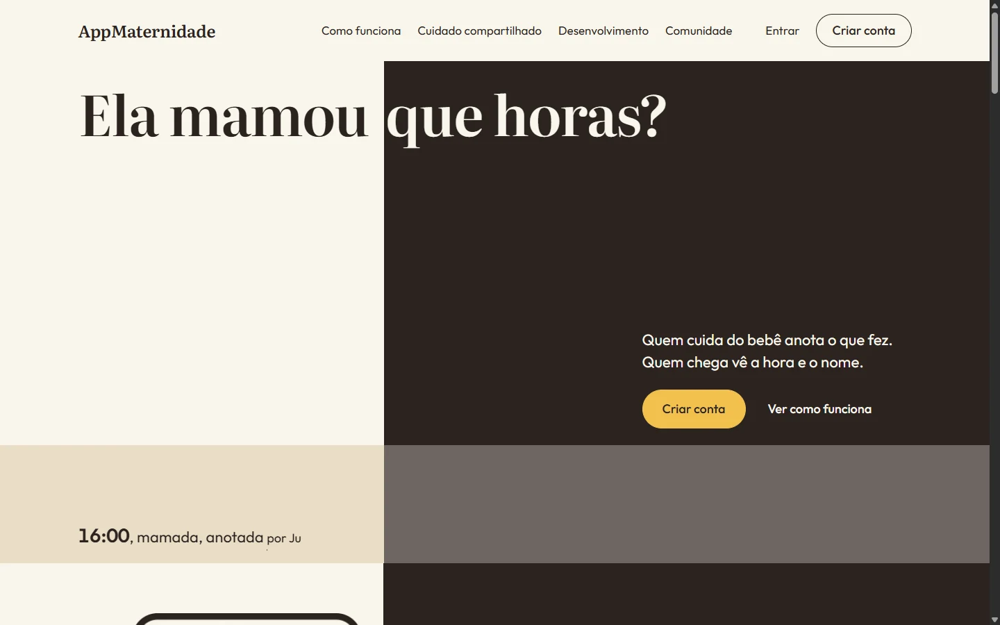
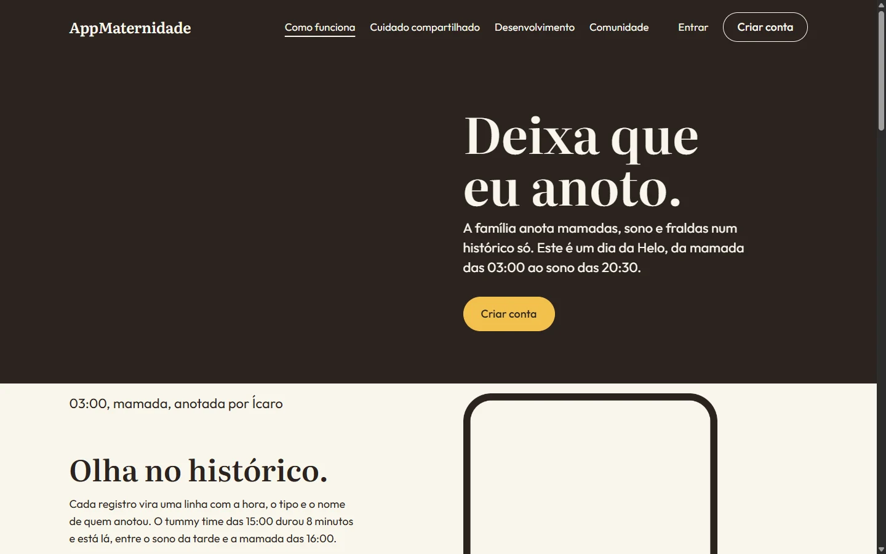
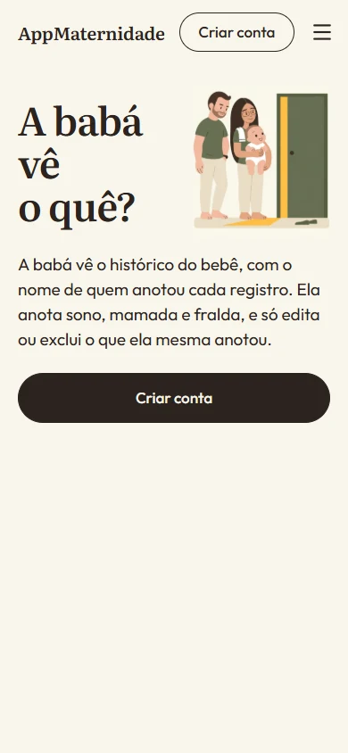
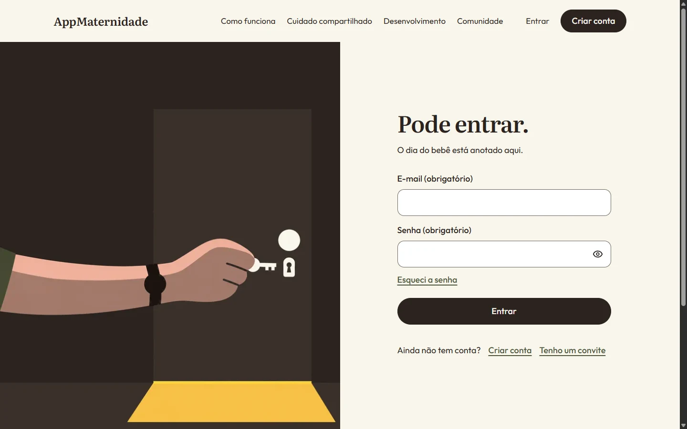
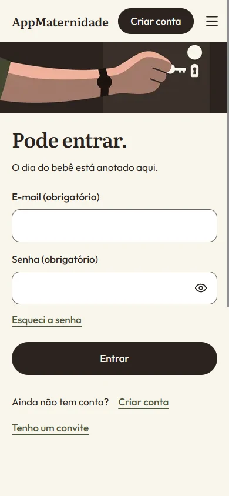

# Guia do Diego

Este guia é para quem chega ao AppMaternidade para melhorar o site, sozinho ou com uma IA própria. Ele aponta para os documentos do repositório em vez de repeti-los. Ele será atualizado quando a nova composição da Home entrar.

> **Qual guia seguir:** o `AGENTS.md` da raiz é para os executores internos do projeto. Você e a sua IA seguem este `DIEGO.md`; do `AGENTS.md` use só o bloco "Conventions", que a seção 7 resume. Se algo do `AGENTS.md` (ferramentas, caminhos locais, fluxo de cartões) contradisser este guia, vale este guia.

## 1. O que é o produto

O AppMaternidade é um site em português do Brasil que ajuda um casal (e outros cuidadores autorizados) a dividir o cuidado com o recém-nascido: registro da rotina (sono, mamada, fralda, mamadeira, tummy time), histórico, notas, família e desenvolvimento do bebê. A ideia central cabe em duas frases: quem cuida anota o que fez; quem chega vê a hora e o nome de quem anotou.

- Site completo primeiro; Android e iOS vêm depois, por port (ADR-009, em `docs/AppMaternidade/06_ADRs/`).
- Stack: React 19, TypeScript, Vite, Tailwind CSS 4, React Router 7 e Supabase.
- Identidade atual: papel quente, cacau, areia e mel como luz; títulos em Literata e texto em Outfit; ilustrações planas de personagens fictícios. A identidade ainda é fraca e está em revisão (seção 4).
- O tom do texto é calmo, direto e sem jargão de aplicativo. Quem lê muitas vezes está de madrugada, com o bebê no colo.

## 2. Mapa do repositório

```
AGENTS.md                  entrada para agentes e as convenções (bloco "Conventions")
docs/DESIGN_DOC_BASE.md    escopo do produto (RF-01 a RF-14), pilares, riscos
docs/AppMaternidade/       documentação temática (00_Inicio, produto, ADRs...)
docs/DIEGO.md              este guia
supabase/                  configuração, migrações e testes do banco
scripts/                   verificação de commits e utilitários da raiz
.github/workflows/         CI e publicação
web/                       o site (tudo que você mexe fica aqui)
```

Dentro de `web/`:

| Pasta | Conteúdo |
|---|---|
| `web/src/rotas.tsx`, `web/src/rotas/` | tabela de rotas (públicas, `app/*`, moderação) |
| `web/src/paginas/` | uma página por rota: `Inicio.tsx`, `publicas/`, `conta/`, `rotina/`, `desenvolvimento/`, `comunidade/`, `avisos/`, `moderacao/` |
| `web/src/componentes/` | `base/` (Botão, Campo, layout), `campo/`, `casca/` (cabeçalho, rodapé, menu), `app/`, `rotina/`, `conta/`, `acesso/`, `comunidade/`, e uma pasta `*-casa` por página pública |
| `web/src/conteudo/` | todos os textos, por tema (`casa/`, `inicio.ts`, `publicas-texto.ts`, `rotina.ts`...) |
| `web/src/dados/` | camada de dados: versão Supabase, versão em memória e versão de demonstração por tema |
| `web/src/styles/`, `web/src/index.css` | tokens, tema gerado, CSS global |
| `web/src/movimento/` | animações e revelações na rolagem |
| `web/src/assets/cenas/`, `web/public/` | ilustrações e imagens servidas |
| `web/assets-fonte/`, `web/scripts/ativos/` | masters de imagem e scripts que as exportam |
| `web/DESIGN.md` | sistema de design: tokens, tipografia, componentes, regras |

Rotas públicas: `/`, `/como-funciona`, `/cuidado-compartilhado`, `/desenvolvimento`, `/comunidade` (via `app/comunidade`), `/sobre`, `/contato`, `/regras-da-comunidade`, `/privacidade`, `/termos`, `/exclusao-de-conta`, `/entrar`, `/criar-conta`, `/recuperar-acesso`, `/convite`. Rotas logadas: `/app/hoje`, `/app/sessao`, `/app/registro/novo`, `/app/historico`, `/app/notas`, `/app/lixeira`, `/app/familia`, `/app/conta`, `/app/avisos`, `/app/desenvolvimento`, `/app/comunidade`. Confira sempre em `web/src/rotas/`.

## 3. O que existe e o que falta

**Existe e funciona:** conta e família com convite, registro dos tipos de cuidado, Hoje, Histórico, Notas, lixeira, sessão de tummy time com cronômetro, avisos, comunidade com denúncia e moderação, páginas públicas e textos de leitura, modo de demonstração sem banco, testes de acessibilidade, contraste, geometria e dados. A base funcional está pronta há bastante tempo.

**Falta, principalmente no visual:**

- A Home está sendo recomposta (ver seção 4); a atual é um conjunto de faixas sem composição coerente.
- Identidade própria pouco desenvolvida: mesmos tons de papel, cacau e mostarda, mesmos desenhos achatados.
- Como funciona, Cuidado compartilhado e Desenvolvimento ainda precisam de redesenho completo.
- As telas logadas funcionam, mas algumas ainda parecem protótipo.
- Quase tudo o que o pilar de comunidade e de desenvolvimento promete está em versão inicial.
- Não está pronto: publicação em main, verificação de Safari/iOS com AVIF, segundo juiz de qualidade e o modo duplo do RF-14.

## 4. Os problemas principais, em palavras simples

1. **A Home não tem composição.** Elementos foram sendo acrescentados faixa por faixa. Na primeira tela de 1440 há muito vazio (um título largo, um bloco escuro e uma faixa cinza), e o texto de apoio fica longe do título. A tela de 390 vira uma pilha de blocos.
2. **A rolagem é tímida.** As animações existem, mas são pequenas: a lâmpada acende, a legenda troca, a faixa desliza poucos pixels. Quem rola quase não sente uma história.
3. **As ilustrações se repetem e são pobres.** Os mesmos desenhos planos (casal com camisetas iguais, lâmpada de cone torto, sem sombra de contato). A mesma janela aparece em 7 páginas; a mesma porta, em 6 páginas de acesso.
4. **Muitas imagens estão borradas.** Das 102 posições de imagem, 35 usam arquivos-fonte pequenos demais para o tamanho com que aparecem. Exportar em 2× ou 3× não resolve: é preciso um master melhor, vetor ou nova geração (planejado para depois da entrega do gerador de imagens).
5. **As páginas não conversam entre si.** A Home ganhou escala de título grande; as outras páginas não. Entrar, Sobre, Como funciona e Cuidado têm primeira tela quase igual à de semanas atrás. Falta um material comum (papel, grão, luz) que atravesse todas.
6. **Sobre é um cartaz escuro** com prédio no canto e texto embaixo; Entrar usa a mesma porta de outras cinco páginas de acesso.
7. **A área logada precisa deixar de parecer protótipo.** Hoje, registro, Histórico, Notas e Família têm de parecer parte do mesmo produto, com dados fictícios convincentes.
8. **Construir e testar não basta.** Teste verde e build verde provam que nada quebrou, não que a tela está boa.

As imagens abaixo mostram o estado atual de algumas telas.

| Tela | Captura |
|---|---|
| Início, 1440 |  |
| Início, 390 |  |
| Como funciona, 1440 |  |
| Cuidado compartilhado, 390 |  |
| Entrar, 1440 |  |
| Entrar, 390 |  |

As capturas da Home pegam a página no início da animação: o estado de carga faz parte do problema, não é um erro da captura.

## 5. O que melhorar

- Hierarquia e composição: um ponto focal por tela, texto perto do que ele explica, sem grandes vazios planos.
- Escala de título coerente entre as páginas, no padrão que a Home terá.
- Menos repetição de ilustrações; onde não houver arte nova, usar tipografia, cor e espaço, não o mesmo desenho de novo.
- Imagens nítidas em 390 e em 1440, sem corte estranho nem borrão.
- Telas logadas com estados bons: vazio, carregando, erro, sucesso, e dados fictícios que pareçam reais.
- Texto sempre em português claro, sem inglês solto.

## 6. Como usar referências sem copiar

O projeto estudou sites premiados e produtos reais só para extrair técnicas, nunca layout, texto, código ou imagem. Use o mesmo critério:

- Escolha rotulada com estado selecionado visível e retorno real da ação (a técnica de Pato Jack).
- Destinos nomeados por fase e chamada precoce (Good Inside).
- Um material único atravessando a história e um gesto marcante (Sweet Tape).
- Captura real do produto como prova ao lado do argumento (Les Intranquilles).
- Arte ancorada na cena aprovada, sem herói altíssimo no celular (Grounded).
- Hierarquia e disciplina de material (Bulletproof).
- Faixas de conteúdo bem distintas e um fecho em contraste (Extrafazant).
- Objeto que cruza a emenda entre duas faixas (visível hoje no tapete entre as faixas 4 e 5 da Home).

Regras: registre só o nome da técnica e a URL pública; não cole trechos, não recorte imagens, não reproduza estrutura de página. Essa é a lista de técnicas que vale para o projeto; os sites são públicos e podem ser encontrados pelo nome.

## 7. Convenções de código e de design

Resumo do bloco "Conventions" do `AGENTS.md` (o original está no `AGENTS.md`):

1. Título de commit com até 72 caracteres e iniciando por maiúscula, no formato em português com verbo no início; sem merge nem commit vazio. Confira com `node scripts/verificar-commits.mjs <base>..HEAD`.
2. Texto aguenta zoom de 200% e viewport de 320 px: sem corte, sobreposição ou rolagem horizontal; palavras longas quebram.
3. Toda mudança de tela traz capturas em 390×844 e 1440×900 (DPR 2) em cada tema que a rota aceita.
4. Links internos, assets e redirecionamentos usam `import.meta.env.BASE_URL`; nunca `"/"` fixo.
5. Cor, espaçamento e tipo vêm dos tokens de `web/DESIGN.md`; nunca hex ou rgb cru em componente.
6. Antes de mudar um componente compartilhado, ache os testes que o usam e atualize-os dentro do escopo; nunca deixe teste vermelho.
7. Testes que dependem de fuso, relógio ou idioma os fixam. Fronteira de palavra em pt-BR usa `(?<![\p{L}])…(?![\p{L}])` com a flag `u`.
8. No site só entram `VITE_SUPABASE_URL` e a chave anon/publishable. Nunca `service_role`, `.env` ou segredo no Git.

Mais regras de design:

- **Tokens:** definidos em `web/src/styles/tokens.css` e no tema gerado (`npm run tema` lê `web/DESIGN.md`). Para mudar uma cor, mude o token, não o componente. Uma troca de paleta chega às suas páginas de graça se você só usar tokens.
- **Tipografia:** Literata (títulos, com corte óptico) e Outfit (texto e interface). Sem caixa alta, sem itálico nas páginas públicas, nada menor que 15 px.
- **Texto em pt-BR:** acentuação correta, sem anglicismo desnecessário, sem promessa médica, rótulos de campo claros. Textos vivem em `web/src/conteudo/`, não no JSX.
- **Imagens:** com `width`/`height` ou proporção fixa, `alt` útil (ou vazio se decorativa) e fonte nítida no tamanho de uso.
- **Movimento:** respeite `prefers-reduced-motion`; use as primitivas de `web/src/movimento/`.

## 8. Rodar, testar e visualizar

Requisitos: Node 24 e npm. Tudo em `web/`:

```sh
cd web
npm ci            # instala exatamente o que está no lock
npm run dev       # servidor local (normalmente http://localhost:5173/)
npm run typecheck # tsc -b --noEmit
npm run lint      # ESLint + stylelint, sem avisos
npm run test      # Vitest (jsdom): rotas, axe, contraste, geometria, dados
npm run build     # build de produção em web/dist/
npm run check     # typecheck + lint + build + test, para na primeira falha
npm run tema      # regenera o tema a partir de DESIGN.md
```

- **Sem Supabase:** não faça nada. Sem `VITE_SUPABASE_URL` e `VITE_SUPABASE_ANON_KEY`, o site roda em modo memória/demonstração, com dados fictícios, e mostra um aviso de demonstração. É o modo certo para trabalho visual.
- **Com Supabase:** crie `web/.env.local` (fora do Git) com a URL e a chave **publishable/anon**. O build tem uma trava: se `VITE_SUPABASE_ANON_KEY` trouxer `sb_secret_` ou um JWT que não seja `anon`, o `npm run build` para e o erro nomeia a variável sem mostrar o valor. Nunca use outra chave.
- **Pré-visualizar o build:** `npm run build` e depois `npx vite preview --host 127.0.0.1`. Para publicar sob subcaminho, o build lê `BASE_SITE` (começa com `/`); por isso os links usam `BASE_URL`.
- Para ver a tela logada sem conta, use o modo de demonstração (rota `/app/hoje`).

## 9. Régua de qualidade

Antes de dizer que algo está pronto, abra a página e olhe:

- **390×844:** a primeira tela comunica o que é a página, o texto não encosta nas bordas, o botão principal alcança o dedo, nada vaza para o lado.
- **1440×900:** a composição ocupa o espaço com intenção, o texto não fica a 800 px do título, a imagem está nítida.
- **Rolando:** sem saltos, sem faixa solta, sem emenda que pareça defeito; com movimento reduzido tudo continua legível.

Build e testes são necessários, não suficientes. Um cartão só está pronto quando um olhar humano nos dois tamanhos aprova.

**Portões de acessibilidade (todos obrigatórios):**

- contraste mínimo AA (4,5:1 para texto, 3:1 para componentes);
- foco visível em tudo que se interage;
- uso completo pelo teclado, sem armadilha de foco;
- `prefers-reduced-motion` respeitado;
- legível com texto a 200% e com viewport de 320 px;
- nenhuma rolagem horizontal.

## 10. Divisão de trabalho

**Diego é dono** de (atualizado em 25/11, para dar a ele frentes inteiras sem conflito com os agentes):

- as telas logadas `/app`: `web/src/paginas/rotina/**`, `desenvolvimento/**`, `comunidade/**`, `avisos/**`, `moderacao/**`, e os componentes só delas: `web/src/componentes/app/**`, `rotina/**`, `resumo-rotina/**`, `avisos/**`, `comunidade/**`, `moderacao/**`, além de `web/src/componentes/desenvolvimento/**` e `web/src/conteudo/desenvolvimento/**`;
- as páginas de acesso: `web/src/paginas/conta/**` (Entrar, Criar conta, Recuperar acesso, Convite, Família, Conta) e `web/src/componentes/acesso/**`, `web/src/componentes/conta/**`;
- os testes dessas telas e o polimento funcional e visual dentro desses escopos.

**Reservado agora para outra frente:** a página pública Desenvolvimento (`web/src/paginas/publicas/Desenvolvimento.tsx`, `desenvolvimento.casa.test.tsx`, `web/src/componentes/desenvolvimento-casa/**` e `web/src/conteudo/casa/desenvolvimento.ts`) está em redesenho. Não edite esses arquivos até este guia liberar.

**A equipe é dona** de:

- as demais páginas públicas: Como funciona, Cuidado compartilhado, Sobre, Contato e 404 (`web/src/paginas/publicas/**` exceto Desenvolvimento, `web/src/componentes/como-casa/**`, `cuidado-casa/**`, `nao-encontrada-casa/**`, `publicas-texto/**`, `web/src/conteudo/casa/**` e `web/src/conteudo/publicas-texto.ts`; o texto legal continua só do Daniel);
- a Home: `web/src/paginas/Inicio.tsx`, `web/src/componentes/inicio-casa/**`, `web/src/componentes/inicio/**`, `web/src/movimento/**`, `web/src/conteudo/inicio.ts` e as imagens da Home (`web/src/assets/cenas/inicio*/**`);
- o design system compartilhado: `web/src/styles/**`, `web/src/index.css`, `web/src/main.tsx`, `web/DESIGN.md`, os tokens;
- a casca e o layout compartilhados: `web/src/componentes/casca/**`, `web/src/componentes/Layout.tsx`, `web/src/componentes/base/**`, `web/src/componentes/campo/**`, `web/src/componentes/secoes/**`;
- build, CI e configuração: `.github/**`, `web/vite.config.ts`, `web/package.json` e o lock, `web/build/**`, `supabase/**`;
- masters e scripts de imagem: `web/scripts/ativos/**`, `web/assets-fonte/**`.

**Quando você precisa mudar algo da equipe,** escreva um pedido na descrição do seu PR (o que, onde, por quê, captura). Não edite o arquivo direto.

**Caminho de contribuição:**

1. Trabalhe na branch `Diego` (ou `diego/<tema>` saindo dela).
2. Abra PR sempre contra `Diego`, nunca contra `main`.
3. A equipe revisa e integra na branch de integração interna.
4. Nada chega à `main` sem Daniel.

**Dependências:** a nova composição da Home e uma possível mudança de paleta (decisão do Daniel) vão mexer nos tokens. Use só tokens, nunca cor crua, e a troca chega às suas páginas sem retrabalho. Imagens novas ou melhores (masters) chegam depois do gerador de imagens e entram pela equipe.

## 11. Tarefas para começar agora

1. **Telas logadas:** passe pelos fluxos Hoje, Registro, Histórico, Notas e Família em 390 e 1440, com dados fictícios, e liste ou corrija o que parece protótipo (espaçamento, estado vazio, rótulos, ritmo vertical).
2. **Estados:** confira vazio, carregando e erro de cada tela logada; texto em português, ação clara, foco visível.
3. **Família e Convite:** deixe o convite, a lista de pessoas e os estados (pendente, aceito, erro) claros em 390 e 1440, com dados fictícios e ações evidentes.
4. **Entrar e Criar conta:** deixe o formulário e a ilustração equilibrados em 1440 e empilhados com boa ordem em 390; revise mensagens de erro de campo.
5. **Conta e Recuperar acesso:** revise hierarquia, mensagens e confirmações de ações sensíveis (sair, excluir), sem mudar o texto legal.
6. **Auditoria de acessibilidade:** rode os testes de axe, ande por teclado em cada página sua e registre os achados com captura.
7. **Imagens:** liste os slots borrados nas suas páginas (pedido no PR) em vez de reexportar em 2×.

Sugestão de fluxo com IA própria: dê à ferramenta este guia, `web/DESIGN.md` e o bloco "Conventions" do `AGENTS.md`; peça mudanças pequenas por PR; sempre rode `npm run check` e confira as telas à mão nos dois tamanhos.

## 12. Plano resumido de sexta (27/11)

- **Essencial:** Home com a nova composição integrada (ou, se não ficar pronta, a Home atual com rua, luz e grão e a nova tipografia); páginas públicas navegáveis e consistentes em 390 e 1440; os fluxos principais de `/app` apresentáveis com dados fictícios; sem imagem quebrada ou borrada nas páginas mostradas; link de pré-visualização pronto (a publicação depende do sim do Daniel).
- **Importante:** faixa da porta; masters de imagem trocados onde são pequenos, depois que o gerador entregar; o seu polimento do `/app` e das páginas de acesso; paleta "hora azul" só se Daniel escolher.
- **Depois:** redesenho completo de Como funciona, Cuidado e Desenvolvimento, os dois modos do RF-14, checagem de AVIF no Safari/iOS, publicação em `main`.

## 13. Segurança do que é público

Este repositório é público. Nunca coloque no código, nos textos, nas capturas ou nos PRs: caminhos do seu computador, e-mails ou dados reais, chaves e senhas, fotos de pessoas reais (só desenhos de personagens fictícios), nem texto, código ou imagem copiados de outros sites.

## 14. Atualizações deste guia

A nova composição da Home e uma eventual troca de paleta vão alterar partes das seções 4, 5 e 10. Este guia será atualizado quando essa composição entrar.
